# 📘 G.B.F. Enterprise HR & AI Management System (`v9.4.0 Production LTS / @44`)
## 🖥️ Visual Application Guide & Official User Manual (တကယ့် Application မျက်နှာပြင်များဖြင့် အသေးစိတ် အသုံးပြုသူ လက်စွဲ)

**GBF Enterprise HR & AI Management System (`v9.4.0 Production LTS`)** သည် Google Sheets (`11` Master Tables — **`KPI_Formula_Registry`** တွက်ချက်မှု Audit Table အပါအဝင်), Google Apps Script Serverless Backend, Gemini 3.8 Flash AI (`gemini-3.8-flash` Interactions API), Telegram Native Mini App (`Index.html` — **MLBB Astral Steel-Navy & 5-Hue Color Harmony HUD** + Top-of-Home Calendar Strip + iOS Native Ergonomics) နှင့် Scoped Telegram Bot / Group Command Center (`@GBF_HRMS_Bot`) တို့ကို တစ်စုတစ်စည်းတည်း ချိတ်ဆက်ထားသော Enterprise HR ပလက်ဖောင်း ဖြစ်ပါသည်။

---

### 🔗 တရားဝင် အသုံးပြုရမည့် လင့်ခ်များ
* **🌐 Web App / Telegram Mini App:** `https://script.google.com/macros/s/AKfycbyRMUJDUbPJidoXDNrYycqS-WU_AS5Mech41ul7fO88VJYoqKg62SzNmPWkUg0G-kHx/exec`
* **🤖 Official Telegram Bot:** `@GBF_HRMS_Bot` (`https://t.me/GBF_HRMS_Bot`)
* **⏰ Timezone & Geofence Default:** `Asia/Rangoon` (`GMT+6:30`) • Office HQ `500 m` Geofence

---

### 📑 မာတိကာ (Table of Contents)
1. [Role အလိုက် လုပ်ပိုင်ခွင့် ဇယား (RBAC Matrix)](#-role-အလိုက်-လုပ်ပိုင်ခွင့်-ဇယား-rbac-matrix)
2. [စနစ်ဝင်ရောက်ခြင်း၊ Signed Telegram SSO နှင့် PIN Vault](#-၁-စနစ်ဝင်ရောက်ခြင်း-signed-telegram-sso-နှင့်-pin-vault)
3. [ပင်မစာမျက်နှာ (`ပင်မ`) — GPS Check-In/Out, Avatar Stack & Squads](#-၂-ပင်မစာမျက်နှာ-ပင်မ--gps-check-inout-avatar-stack--squads)
4. [Compact Month Switcher, MLBB 5-Axis Radar & Battle Telemetry](#-၃-compact-month-switcher-mlbb-5-axis-radar--battle-telemetry)
5. [Profile, MLBB Reward Pass & Weekly MVP Streak Chest](#-၄-profile-mlbb-reward-pass--weekly-mvp-streak-chest)
6. [History Calendar (`Weekly / Daily / Monthly`) & Timeline](#-၅-history-calendar-weekly--daily--monthly--timeline)
7. [50% Salary Wallet, Advance Ledger & Official Payslip (`PDF` / `Drive`)](#-၆-50-salary-wallet-advance-ledger--official-payslip-pdf--drive)
8. [Quick Actions (`+`) — Leave, Advance Chips, HR-AI Voice & 3-Team Rollout](#-၇-quick-actions---leave-advance-chips-hr-ai-voice--3-team-rollout)
9. [Executive AI Command & Reward Settings (`TM / MM / TL` Only)](#-၈-executive-ai-command--reward-settings-tm--mm--tl-only)
10. [Telegram Group Live Board, Private Bot Menu & Multi-Approver Sync](#-၉-telegram-group-live-board-private-bot-menu--multi-approver-sync)
11. [Offline Mode (`IndexedDB` Outbox), Policies & Troubleshooting FAQ](#-၁၀-offline-mode-indexeddb-outbox-policies--troubleshooting-faq)

---

### 👥 Role အလိုက် လုပ်ပိုင်ခွင့် ဇယား (RBAC Matrix)

| Position Layer | ရာထူးများ | Mini App Permissions | Telegram Bot / Approval Routing |
| :--- | :--- | :--- | :--- |
| **TM** | CEO / Top Management / Director | Dashboard အပြည့် + **`Admin` Tab** (`Run AI Analysis`, `Generate Payroll`) + **`🎁 ဆုကြေးသတ်မှတ်ရန်` Modal** + 3-Team Rollout | `TL / MM` ခွင့်နှင့် ကြိုငွေများကို Approve/Reject လုပ်ခွင့် + HR Voice တင်ပြချက်များ လက်ခံညှိနှိုင်းခွင့် + TL မရှိချိန် Escalation |
| **MM** | Manager / HR / Executive | Dashboard + **`Admin` Tab** + Reward Settings Modal | `HR Watch` (`APPROVER_HR_WATCH_IDS`) အဖြစ် Request အားလုံး Real-Time CC နှင့် Co-Approve လုပ်ခွင့် + HR Voice စစ်ဆေးခွင့် |
| **TL** | Team Leader | Dashboard + **`Admin` Tab** + Reward Settings Modal + Team ဖွဲ့စည်းခွင့် | မိမိအဖွဲ့ဝင် `TT / JT / ST` များ၏ Leave & Advance များကို Approve/Reject လုပ်ခွင့် |
| **ST / JT / TT** | Senior, Junior & Trainee Technicians | GPS Check-In/Out, Today Attendance/Squads ကြည့်ရှုခြင်း, Leave/Advance/Voice တင်ပြခြင်း, Payslip `PDF`/`Drive` | DM Receipt များ + `/checkin`, `/mykpi`, `/wallet`, `/payslip`, `/askai` + Group `/board`, `/teams` |

---

## ၁။ စနစ်ဝင်ရောက်ခြင်း၊ Signed Telegram SSO နှင့် PIN Vault

| **Live Application Screen — Tactical PIN Vault** | **ဝင်ရောက်ပုံ အဆင့်ဆင့် (Step-by-Step)** |
| :---: | :--- |
| 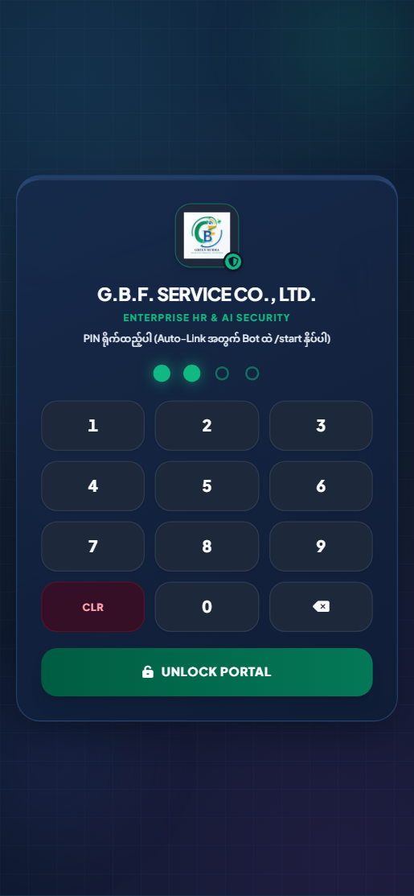 | **နည်းလမ်း (၁) — Telegram Auto-SSO (အမြန်ဆုံး):** 1. `@GBF_HRMS_Bot` Private Chat ထဲတွင် `/start` (သို့) `/app` ပို့ပါ။ 2. Bot က ပေးပို့သော **`🚀 Open GBF HR Mini App`** (သို့) ဘယ်ဘက်အောက်ခြေ `GBF HR App` Menu Button ကို နှိပ်ပါ (URL ထဲတွင် `?tg_id=&tg_sig=` **HMAC-SHA256** လက်မှတ် ပါဝင်သည်)။ 3. ပထမဆုံးအကြိမ်သာ ဂဏန်း ၄ လုံး PIN ရိုက်ထည့်လိုက်ပါက စနစ်က `HR_Employees` တွင် `Telegram_Chat_ID` ကို **Auto-Bind** လုပ်ပေးပြီး `"Telegram ID ချိတ်ဆက်ပြီးပါပြီ (Auto-SSO Ready)"` ဟု ပြသပါမည်။ နောက်တစ်ကြိမ်မှစ၍ PIN ထပ်ရိုက်ရန် မလိုဘဲ တိုက်ရိုက်ပွင့်ပါမည်။  **နည်းလမ်း (၂) — Bot Chat `/link <PIN>`:** Bot Private Chat ထဲတွင် `/link 1234` (သင်၏ PIN) ဟု ပို့၍လည်း Chat ID ကို ချိတ်ဆက်နိုင်ပါသည်။ *(Security Note: ၁ နာရီလျှင် `/link` အမှား ၅ ကြိမ်သာ ကြိုးစားခွင့် Rate Limit နှင့် အခြားသူအကောင့် ထပ်မချိတ်မိစေရန် Conflict Guard ပါရှိပါသည်)*  **နည်းလမ်း (၃) — Tactical Keypad (Web Browser):** `0–9` ခလုတ်များဖြင့် PIN ရိုက်၍ `UNLOCK PORTAL` ကို နှိပ်ပါ (`CLR` = အားလုံးဖျက်ရန်၊ `⌫` = နောက်ဆုံးတစ်လုံး ဖျက်ရန်)။ |

---

## ၂။ ပင်မစာမျက်နှာ (`ပင်မ`) — GPS Check-In/Out, Avatar Stack & Squads

| **Check-In & Today Attendance Inspector** | **Active Battle Squads (`Daily_Teams`)** |
| :---: | :---: |
| 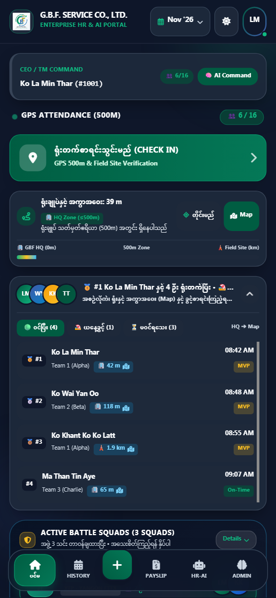 | 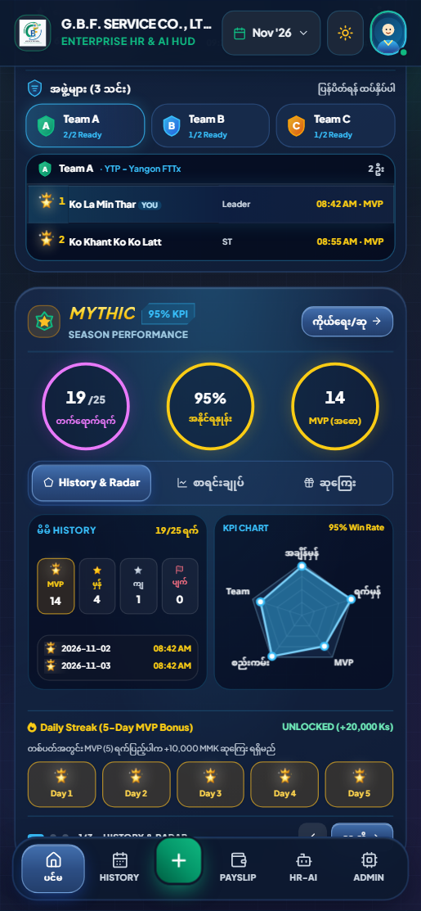 |

### မျက်နှာပြင် အစိတ်အပိုင်းတစ်ခုချင်းစီ ရှင်းလင်းချက် (`Option A Unified Bento HUD + Option 2 Top Calendar`)
1. **Header Brand & Portrait Bar:** ဘယ်ဘက်ထိပ်တွင် **GBF Logo Emblem** (Google Sheet logo URL သို့ offline SVG emblem fallback) နှင့် ညာဘက်ထိပ်တွင် Profile ဓာတ်ပုံမတင်ရသေးသူများအတွက်ပါ **အမြဲမြင်သာသော Human Portrait SVG Avatar** ပါရှိပါသည်။
2. **Top Leader Command Strip (`TM / MM / TL` Only):** `CEO / TM Command` ကဲ့သို့ ရာထူးအမည်၊ **`Squads`** နှင့် **`AI Command`** shortcut ခလုတ်များကို ပြသပေးပါသည်။
3. **Top-of-Home Date Calendar (`#home-calendar-top-card` — Option 2 Smart Strip + Month Drawer):**
   * **7-Day Week Strip & Month Dropdown:** GPS Arena အပေါ်ဆုံးတွင် တစ်ပတ်စာ နေ့စွဲများကို အရောင် Dot များ (`🟡 MVP` / `🟢 On-Time` / `🔴 Late` / `🔵 Squad/Activity`) ဖြင့် ပြသထားပြီး Month ခေါင်းစဉ်နှိပ်၍ Full Month Drawer ဖွင့်ကြည့်နိုင်သလို `<` `>` ခလုတ်များဖြင့် လကူးပြောင်းနိုင်ပါသည်။
   * **Daily Personal Check-In & Battle Squad Card:** ရက်စွဲတစ်ခုခုကို နှိပ်လိုက်သည်နှင့် မိမိ၏ **`IN → OUT`** အချိန်၊ KPI Badge နှင့် ထိုနေ့တွင် တွဲဖက်တာဝန်ကျခဲ့သော **Battle Squad & Members** ကို ချက်ချင်းပြသပေးပြီး အောက်ဘက် **Roster နှင့် Battle Squads Card များကိုပါ ထိုနေ့ Data (`month_daily_snapshots`) အတိုင်း Sync** ပြောင်းလဲပေးပါသည်။ (`ယနေ့သို့` / `Live ယနေ့` ဖြင့် ယနေ့ Live Board သို့ ပြန်ကူးနိုင်သည်)။
4. **Unified `GPS ARENA · 500M OPS` & Live HQ Telemetry Card (`CHECK IN` / `CHECK OUT` + Single `#active-counter`):**
   * **Single Live Active Counter:** ညာဘက်ထောင့်ရှိ Users SVG badge (`6 / 16`) ကို နှိပ်၍ ယနေ့ Check-In Roster ကို တိုက်ရိုက် ဖွင့်/ပိတ်နိုင်ပါသည်။
   * **မနက်ပိုင်း (`NOT_CHECKED_IN`):** အစိမ်းရောင် **`ရုံးတက်စာရင်းသွင်းမည် (CHECK IN)`** ခလုတ်ပေါ်နေပါမည်။ နှိပ်လိုက်သည်နှင့် Browser/Telegram မှ GPS Coordinate ကို ရယူပြီး စာရင်းသွင်းပါသည်။
   * **ရုံးဆင်းချိန် (`CHECKED_IN`):** ခလုတ်သည် အနီရောင် **`ရုံးဆင်းစာရင်းသွင်းမည် (CHECK OUT)`** (`Checked In at 08:42 AM`) အဖြစ် ပြောင်းသွားပါမည်။
   * **နှစ်ခုလုံးပြီးစီးချိန် (`CHECKED_OUT`):** **`ယနေ့ တာဝန်ချိန် ပြီးဆုံးပါပြီ`** (`IN • OUT` အချိန်တွဲဖက်) ပြသပေးပါသည်။
   * **Integrated Live HQ Distance & Map Bar:** GBF HQ (`16.804683, 96.177149`) မှ **≤ 500 m** အတွင်းဖြစ်ပါက `HQ Zone (≤500m)` SVG badge၊ **> 500 m** ဖြစ်ပါက `Field Site` Pylon SVG badge ပြသပြီး **`တိုင်းမည်`** နှင့် **`Map`** ခလုတ်များ တစ်ကတ်တည်းတွင် ပါဝင်ပါသည်။
5. **Today Checked-In Avatar Stack Inspector:**
   * Avatar အဝိုင်းများကို နှိပ်၍ ဖွင့်လိုက်ပါက Telegram Semantic SVG Icon Tabs ၃ မျိုး ခွဲကြည့်နိုင်ပါသည်-
     * **`ဝင်ပြီး (N)`:** Arrival rank (`#1`, `#2`, ...), Team အမည်, HQ Building / Field Pylon SVG `42 m / 1.9 km` (နှိပ်၍ Map ဖွင့်နိုင်), Check-In အချိန်နှင့် `MVP` / `On-Time` Badge။
     * **`ယနေ့ခွင့် (N)`:** Approved / Pending ခွင့်ယူထားသူများ။
     * **`မဝင်ရသေး (N)`:** ယနေ့ Check-In မဝင်ရသေးသူ ဝန်ထမ်းများ။
6. **ACTIVE BATTLE SQUADS:** `Daily_Teams` တွင် ဖွဲ့စည်းထားသော ယနေ့ (သို့မဟုတ် Top Calendar မှ ရွေးချယ်ထားသောနေ့) **Team 1 (Alpha)**, **Team 2 (Beta)**, **Team 3 (Charlie)** စာရင်း (`Crown` SVG Leader badge နှင့် exact member token check ပါဝင်) နှင့် **`Details ▾`** နှိပ်၍ Member စာရင်းအပြည့် ကြည့်နိုင်ပါသည်။ (`0` Squad ဖြစ်နေချိန်တွင် **`+ Squad ဖွဲ့မည်`** Actionable Banner ပြသပေးသည်)။

> **⏰ အချိန်အလိုက် Check-In KPI စည်းမျဉ်း (`Asia/Rangoon GMT+6:30`)**
> * **≤ `09:00 AM`:** `👑 MVP` (Daily MVP Bonus **+1,000 MMK** ရရှိ)
> * **`09:01 AM` – `09:15 AM`:** `🟢 On-Time` (အချိန်မှန်၊ ဒဏ်ကြေးမရှိ)
> * **> `09:15 AM`:** `❗ Late` (တစ်လ `၃` ကြိမ်အထိ ကင်းလွတ်ခွင့်၊ `၄` ကြိမ်မြောက်မှစ၍ `(Late - 3) × 2,000 MMK` နုတ်ယူ)

---

## ၃။ Compact Month Switcher, MLBB 5-Axis Radar & Battle Telemetry

| **Compact Month Switcher (`Select Period`)** | **Slide 1: 5-Axis Hero Radar Chart** | **Slide 2: Battle Telemetry & Metric Inspector** |
| :---: | :---: | :---: |
| 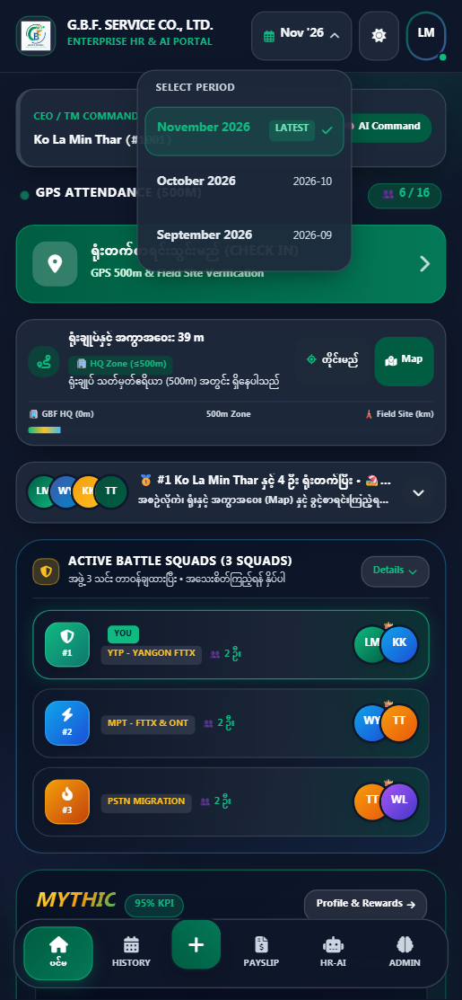 | 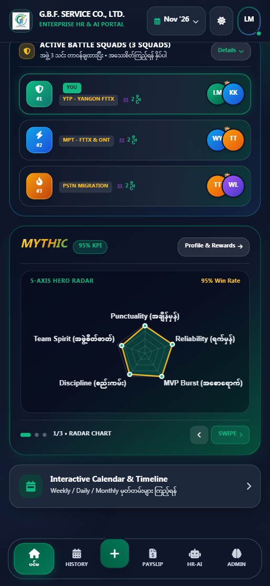 | 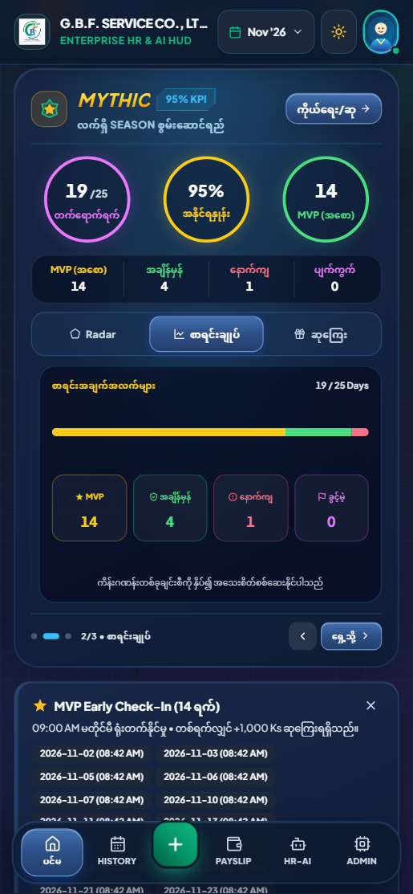 |

* **Sticky Header Controls:**
  * **`Nov '26 ▾` (Compact Month Switcher):** လဟောင်း/လသစ် (`LATEST` badge ပါ) များကို ရွေးချယ်၍ ထိုလအတွက် Radar, KPI, Calendar နှင့် Official Payslip များကို တစ်ပြိုင်နက် ပြောင်းလဲကြည့်ရှုနိုင်ပါသည်။ (Offline outbox item ရှိပါက ☁️ **Outbox Pill** ဘေးတွင် ပေါ်လာပြီး နှိပ်၍ Sync လုပ်နိုင်ပါသည်)
  * **`☀️ / ⚙️` Dark Slate Toggle & Profile Avatar:** Theme ပြောင်းလဲခြင်းနှင့် **`Open Profile`** စာမျက်နှာသို့ တိုက်ရိုက်ဝင်ရောက်ခြင်း။
* **Season Mastery Hero HUD (`Radar | စာရင်းချုပ် | ဆုကြေး` iOS Segmented Switcher — 3 Rings + 4-Chip Micro-Strip):**
  * **3 Hero Telemetry Rings:** Dynamic **`Present / Month_WorkDays`** (`19 /25`), **`Win Rate %` (`အနိုင်ရနှုန်း`)**, **`MVP (အစော)`** + အောက်တွင် **4-Chip Micro-Strip (`MVP · အချိန်မှန် · နောက်ကျ · ပျက်ကွက်`)** တွဲဖက်ပြသပေးပါသည်။
  * **Slide 1 (`1/3 • Radar ဝင်ရိုး`):** Spiderweb Pentagon Mesh Radar တွင် **`အချိန်မှန်မှု (Punctuality)`**, **`ရက်မှန်မှု (Reliability)`**, **`MVP (အစော)`**, **`စည်းကမ်း (Discipline)`**, **`အဖွဲ့စိတ်ဓာတ် (Team Spirit)`** ဝင်ရိုး ၅ ခု + Win Rate `%` ကို MLBB Astral Neon Mesh ဖြင့် ပြသပါသည်။
  * **Slide 2 (`2/3 • စာရင်းချုပ်`):** Present / Monthly Working Days (`System_Settings`) ဘားနှင့် **`MVP`**, **`OnTime`**, **`Late`**, **`AFK`** SVG ခလုတ် ၄ ခု — ခလုတ်တစ်ခုခုကို နှိပ်လိုက်ပါက အောက်ဘက်တွင် **Single Metric Inspector** (ရက်စွဲ + Check-In အချိန် Badges နှင့် **`မျက်နှာပြင်အပြည့် အသေးစိတ်ကြည့်ရန် →`**) ပွင့်လာပါမည်။
  * **Slide 3 (`3/3 • ဆုကြေး & Wallet`):** စုစုပေါင်း ရရှိပြီး ဆုကြေးစုစုပေါင်း (`Total Earned Rewards`) နှင့် `50% Wallet Available` gauge bar။

---

## ၄။ Profile, MLBB Reward Pass & Weekly MVP Streak Chest

| **Profile Card & Season Rank (`MYTHIC`–`WARRIOR`)** | **Weekly MVP Streak Chest & KPI Breakdown** |
| :---: | :---: |
| 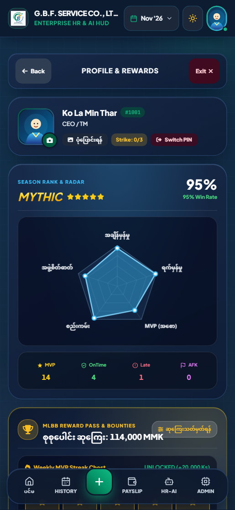 | 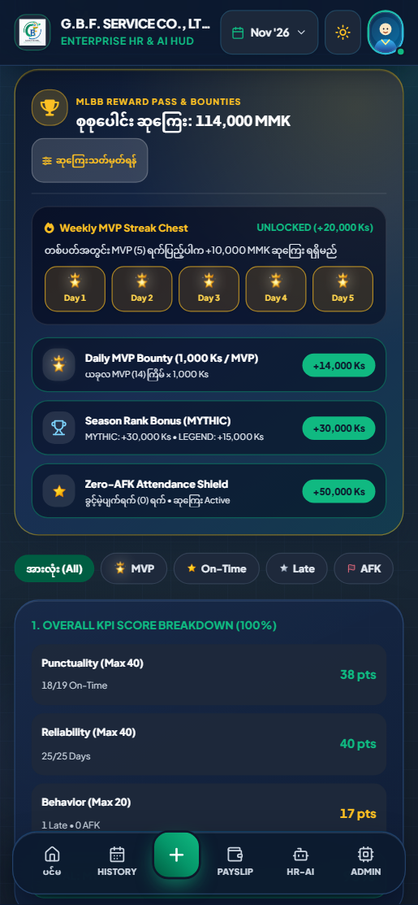 |

* **Profile Card Controls:**
  * **`📷 / ပုံပြောင်းရန်`:** ကိုယ်ပိုင် Profile ဓာတ်ပုံ ပြောင်းလဲသိမ်းဆည်းနိုင်ပါသည်။
  * **`Strike: 0/3`:** စည်းကမ်းထိန်းသိမ်းမှု Strike မှတ်တမ်း (`2 points` per Strike in Behavior KPI)။
  * **`Switch PIN`:** လက်ရှိ session မှ ထွက်၍ အခြားဝန်ထမ်း PIN ဖြင့် ဝင်ရောက်ရန်။
* **Weekly MVP Streak Chest & Reward Pass Bounties:**
  * ISO Week (တနင်္လာ–တနင်္ဂနွေ) တစ်ပတ်အတွင်း MVP **၅ ရက်** ပြည့်တိုင်း ကြယ် ၅ ပွင့် ပြည့်ကာ **`+10,000 MMK / Week`** unlocked ဖြစ်ပါမည်။
  * **`⚙️ ဆုကြေးသတ်မှတ်ရန်` (`TM / MM / TL` Only):** Admin/Leaders များသည် ဆုကြေးနှုန်းထားများ၊ လအလိုက် **Monthly Working Days (`WORKING_DAYS_YYYY_MM`)** နှင့် **`KPI_Formula_Registry`** Sync ကို Modal မှ ပြင်ဆင်နိုင်ပါသည်။
* **Path B Enterprise KPI & 5-Axis Radar Formulas (`v9.4.0` — Normalized across Backend, UI & Bot):**
  * **Win Rate (`အနိုင်ရနှုန်း`):** $$\text{Win Rate} = \text{round}\!\left(\frac{\text{MVP} + \text{OnTime}}{\max(1,\; \text{MVP} + \text{OnTime} + \text{Late} + \text{AFK})} \times 100\right)$$ *(Approved Leave မပါဝင်ဘဲ Late နှင့် AFK မရှိမှ 100% ရရှိမည်)*
  * **5 Radar Axes (0–100%):**
    * `Punctuality` = $\text{MVP}+\text{OnTime}$ over total checks (`0%` if `Present = 0`)
    * `Reliability` = $(\text{Month WorkDays} - \text{AFK}) / \text{Month WorkDays}$ (`System_Settings` dynamic denominator)
    * `MVP (အစော)` = $\min(100,\, \text{round}(\text{MVP} / \text{Present} \times 100))$
    * `Discipline` = $\max(0,\, \text{round}(0.5\cdot\text{Punctuality} + 0.5\cdot\text{Reliability} - 15\cdot\text{Strike}))$
    * `Team Spirit` = **Field Operations** ဝန်ထမ်းများအတွက် $\text{Distinct Squad Days} / \text{Present}$ | **Non-Operation ဌာနများ** (`TM`, `MM`, `Support`) အတွက် Check-In Presence rate $\text{Present} / (\text{Present} + \text{AFK})$
  * **KPI Score Formula (0–100%) & Rank Tiers:**
    $$\text{KPI Score} = \underbrace{\min\!\left(40, \frac{\text{WorkDays} - \text{AFK}}{\text{WorkDays}}\times 40\right)}_{\text{Reliability (40)}} + \underbrace{\left(\frac{\text{MVP}+\text{OnTime}}{\text{Total Checks}}\times 40\right)}_{\text{Punctuality (40)}} + \underbrace{\max(0,\, 20 - 3\cdot\text{Late} - 10\cdot\text{AFK} - 2\cdot\text{Strike})}_{\text{Behavior (20)}}$$ *(when `Present = 0`, `KPI Score = 0` and Rank = `WARRIOR`)*

| Tier | Score / Condition | Stars | Default Rank Bonus |
| :--- | :--- | :---: | :--- |
| 🌟 **MYTHIC** | `KPI >= 90%` | ⭐⭐⭐⭐⭐ | **`+30,000 MMK`** |
| ⚔️ **LEGEND** | `KPI >= 80%` | ⭐⭐⭐⭐ | **`+15,000 MMK`** |
| 🛡️ **EPIC** | `KPI >= 60%` | ⭐⭐⭐ | `0 MMK` |
| 🎖️ **ELITE** | `KPI >= 40%` *(သို့ `AFK >= 3` Penalty Cap)* | ⭐⭐ | `0 MMK` |
| 🔰 **WARRIOR** | `KPI < 40%` (သို့ Present = `0`) | ⭐ | `0 MMK` |

> **🚨 3-AFK Forfeiture Rule (`PayrollEngine.gs`):** တစ်လအတွင်း ခွင့်မဲ့ပျက်ကွက် (**`AFK >= 3`**) ဖြစ်ပါက Rank ကို အများဆုံး `ELITE` သို့ အလိုအလျောက် လျှော့ချပြီး **Daily MVP, Weekly Streak, Attendance Bonus နှင့် Rank Bonus များအားလုံး ပျက်ပြယ်** ပါမည်။

---

## ၅။ History Calendar (`Weekly / Daily / Monthly`) & Timeline

| **Interactive Calendar & Daily Timeline** | **အသုံးပြုပုံ လမ်းညွှန်** |
| :---: | :--- |
| 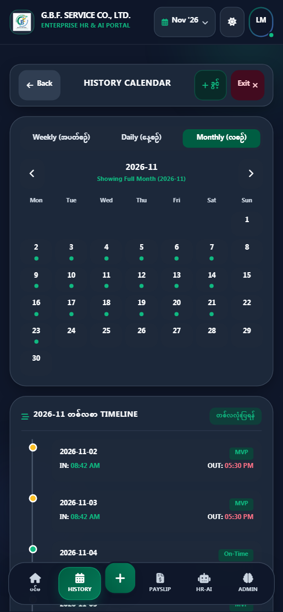 | 1. Bottom Nav မှ **`History`** (သို့ Home မှ **`Interactive Calendar & Timeline`**) ကို နှိပ်ပါ။ 2. အပေါ်ဆုံး Filter မှ **`Weekly (အပတ်စဉ်)`**, **`Daily (နေ့စဉ်)`**, **`Monthly (လစဉ်)`** မြင်ကွင်း ၃ မျိုးကို ပြောင်းလဲကြည့်နိုင်ပါသည်။ 3. ဘယ်/ညာ `<` `>` ခလုတ်များဖြင့် ရက်သတ္တပတ်/လ ရွှေ့နိုင်ပြီး ရက်စွဲတစ်ခုချင်းစီပေါ် နှိပ်ပါက အောက်ဘက် **Timeline** ကို ထိုနေ့တစ်နေ့တည်းအတွက် Filter လုပ်ပြပေးပါမည်။ 4. **`တစ်လလုံးပြရန်`** ခလုတ်နှိပ်၍ Full-Month Timeline သို့ ပြန်ကြည့်နိုင်ပြီး Top-Right **`+ ခွင့်`** ခလုတ်မှ Leave Form သို့ တိုက်ရိုက်သွားနိုင်ပါသည်။ 5. နေ့စွဲကွက်အောက်ရှိ အစက်အရောင်များ — 🟡 `MVP` / 🟢 `On-Time` / 🔴 `Late` / 🔵 `Team/Voice` ကို ကိုယ်စားပြုပါသည်။ |

---

## ၆။ 50% Salary Wallet, Advance Ledger & Official Payslip (`PDF` / `Drive`)

| **50% Salary Wallet & Advance Ledger** | **Official Payslip (`Drive` & `PDF` Export)** |
| :---: | :---: |
| 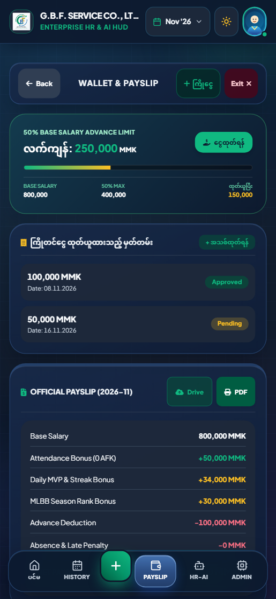 | 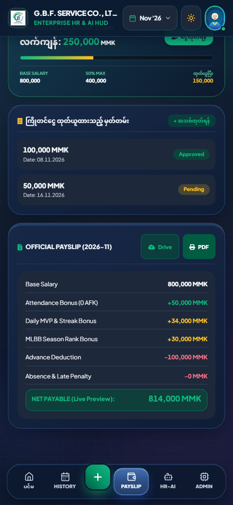 |

* **50% Base Salary Advance Limit Card:**
  * `Base Salary`, `50% Max Limit`, **`ထုတ်ယူပြီး` (`Approved + Pending`)**, နှင့် ကျန်ရှိသော **`လက်ကျန် (MMK)`** ကို Progress Bar ဖြင့် တွက်ချက်ပြသထားပါသည်။
  * **`💵 ငွေထုတ်ရန်`** (သို့ **`+ အသစ်ထုတ်ရန်`**) နှိပ်၍ Advance Salary Request Form သို့ တိုက်ရိုက်သွားနိုင်ပါသည်။
* **Official Payslip (`<yyyy-MM>`):**
  * **`Payroll_Prep_Ledger`** တွင် HR မှ Generate လုပ်ပြီးသားဖြစ်ပါက Approved Ledger ကိုပြသပြီး၊ မလုပ်ရသေးပါက Live Preview (`EST-yyyyMM-empId`) ကို တွက်ချက်ပြသပေးပါသည်။
  * **Bonuses & Deductions Breakdown:** Base Salary `+` Attendance Bonus (`0 AFK: +50,000 MMK`) `+` Daily MVP & Weekly Streak `+` MLBB Season Rank Bonus `-` Approved Advance Deduction `-` Absence Deduction (`AFK × round(Base / Month_WorkDays)` — dynamic `System_Settings` working days) `-` Late Penalty (`Late > 3 => (Late - 3) × 2,000 MMK`) `=` **`NET PAYABLE`**။
  * **`☁️ Drive`:** Google Drive ထဲသို့ `GBF_Payslip_<empId>_<month>.pdf` ဖိုင်အဖြစ် တိုက်ရိုက် Save လုပ်ပေးပါသည်။
  * **`🖨️ PDF`:** Browser Print / PDF Export မျက်နှာပြင် ဖွင့်ပေးပါသည်။

---

## ၇။ Quick Actions (`+`) — Leave, Advance Chips, HR-AI Voice & 3-Team Rollout

Bottom Navigation အလယ်ရှိ **အစိမ်းရောင် `+` ခလုတ်** ကို နှိပ်လိုက်ပါက **Quick Actions Floating Sheet** ပွင့်လာပြီး Form ၄ မျိုးလုံးသို့ ဝင်ရောက်နိုင်ပါသည်-

| **Floating `+ Quick Actions` Sheet** | **Form ၄ မျိုး ဝင်ရောက်ပုံ** |
| :---: | :--- |
| 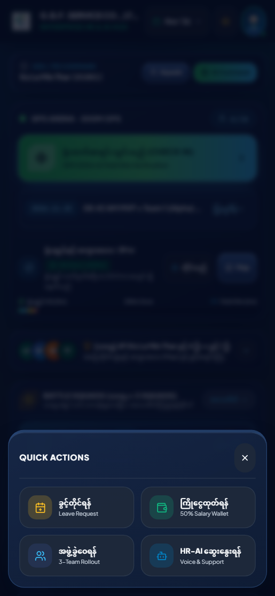 | * **`📅 ခွင့်တိုင်ရန် (Leave Request)`** → Casual / Medical / Annual ခွင့်တိုင်ကြားရန် * **`💵 ကြိုငွေထုတ်ရန် (50% Salary Wallet)`** → 50% Limit အတွင်း လစာကြိုထုတ်ရန် * **`👥 အဖွဲ့ခွဲဝေရန် (3-Team Rollout)`** → Alpha / Beta / Charlie ကွင်းဆင်းအဖွဲ့ ဖွဲ့စည်းရန် * **`🤖 HR-AI ဆွေးနွေးရန် (Voice & Support)`** → လုပ်ငန်းခွင်/စက်ပစ္စည်း/ညှိနှိုင်းမှု တင်ပြရန် *(Form တိုင်းတွင် **Auto-Save Drafts** ပါဝင်သဖြင့် မတော်တဆ ပိတ်မိလျှင်ပင် ရိုက်လက်စ စာသားများ မပျောက်ဆုံးပါ)* |

| **၇.၁ Leave Request** | **၇.၂ 50% Advance + Quick Chips** | **၇.၃ HR-AI Voice (Anonymous)** | **၇.၄ 3-Team Rollout** |
| :---: | :---: | :---: | :---: |
| 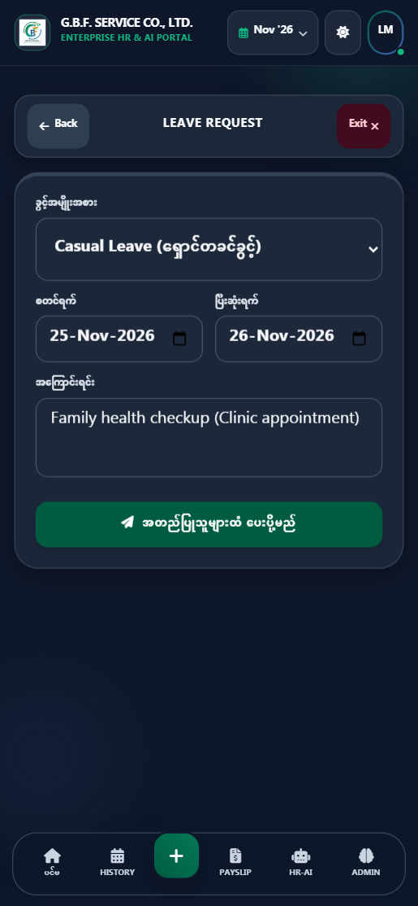 | 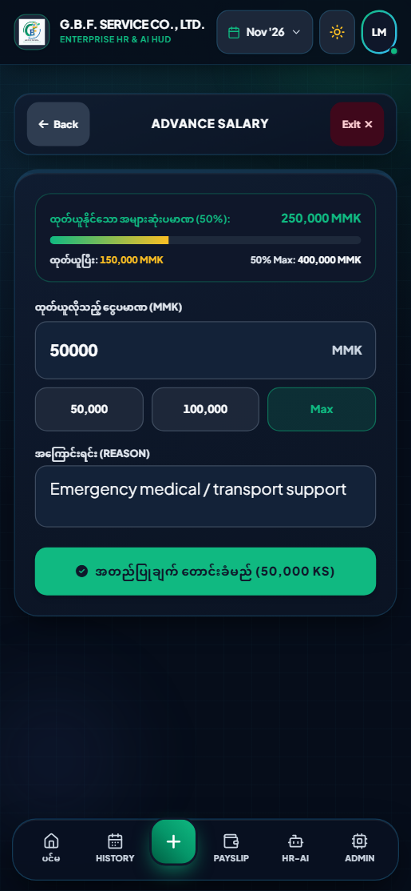 | 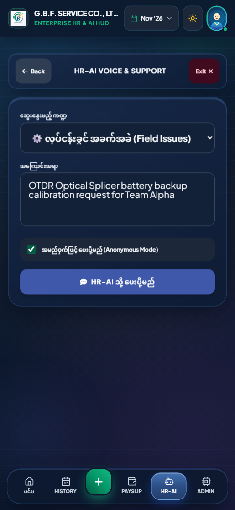 | 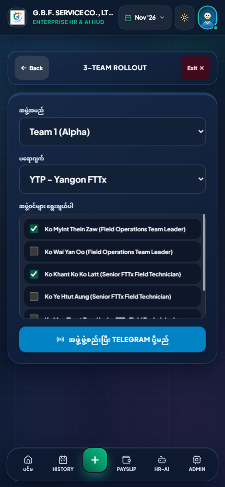 |

1. **၇.၁ ခွင့်တိုင်ကြားလွှာ (`Leave Request`):** Leave Type (`Casual` / `Medical` / `Annual`), Start Date, End Date နှင့် Reason ဖြည့်ပြီး **`အတည်ပြုသူများထံ ပေးပို့မည်`** ကို နှိပ်ပါ။ Gemini 3.8 Flash က **Monday_Bridge / Friday_Bridge** ဟုတ်/မဟုတ်နှင့် Team coverage risk ကို စစ်ဆေးပြီး TL/TM ထံ Telegram Card ပို့ပေးပါမည်။ Approved Leaves များသည် Absent (`AFK`) မဖြစ်ပါ။
2. **၇.၂ လစာကြိုထုတ်ခွင့် (`Advance Salary`):**
   * ထိပ်ဆုံး Progress Bar တွင် လက်ကျန် 50% Limit ကို ကြည့်နိုင်ပြီး **`50,000`**, **`100,000`**, **`Max`** Quick Amount Chips များကို တစ်ချက်နှိပ်၍ ငွေပမာဏ အမြန်ဖြည့်နိုင်ပါသည် (`Remaining` ထက် ကျော်လွန်ပါက `Max` ထိသာ auto-clamp လုပ်ပေးပြီး 50% ကျော်လွန်တောင်းခံမှုကို Server မှ တားဆီးထားသည်)။
   * ငွေပမာဏ ရွေးလိုက်သည်နှင့် Submit ခလုတ်စာသားက **`အတည်ပြုချက် တောင်းခံမည် (50,000 Ks)`** ဟု အလိုအလျောက် ပြောင်းပေးပါသည်။
3. **၇.၃ ဝန်ထမ်းအသံနှင့် ညှိနှိုင်းမှု (`HR-AI Voice & Support`):**
   * ကဏ္ဍ ၄ မျိုး (`Field Issues`, `တောင်းဆိုညှိနှိုင်းမှု`, `Splicer / OTDR စက်ပစ္စည်း`, `အကြံပြုချက်`) မှ ရွေးချယ်ပြီး **`အမည်ဝှက်ဖြင့် ပေးပို့မည် (Anonymous Mode)`** ကို အမှန်ခြစ်ပါက HR/TM ထံ **`ANONYMOUS`** အဖြစ်သာ ပေးပို့ပြီး Gemini AI မှ Sentiment နှင့် နှစ်သိမ့်ဖြေကြားချက် ချက်ချင်းပြန်ပေးပါမည်။
4. **၇.၄ ကွင်းဆင်း ၃-ဖွဲ့ တာဝန်ခွဲဝေမှု (`3-Team Rollout`):**
   * `Team 1 (Alpha)` / `Team 2 (Beta)` / `Team 3 (Charlie)` နှင့် Project (`YTP` / `MPT` / `PSTN`) ရွေးချယ်ပြီး ဝန်ထမ်း Checkbox များ အမှန်ခြစ်ကာ **`အဖွဲ့ဖွဲ့စည်းပြီး Telegram ပို့မည်`** ကို နှိပ်ပါက `Daily_Teams` Sheet တွင် သိမ်းဆည်းပြီး Group Board + ပါဝင်သူတိုင်း၏ Private DM ထံ Receipt ပေးပို့ပေးပါမည်။

---

## ၈။ Executive AI Command & Reward Settings (`TM / MM / TL` Only)

| **Admin Executive AI Command & Watchlist** | **Reward Settings Modal (`System_Settings` Sync)** |
| :---: | :---: |
| 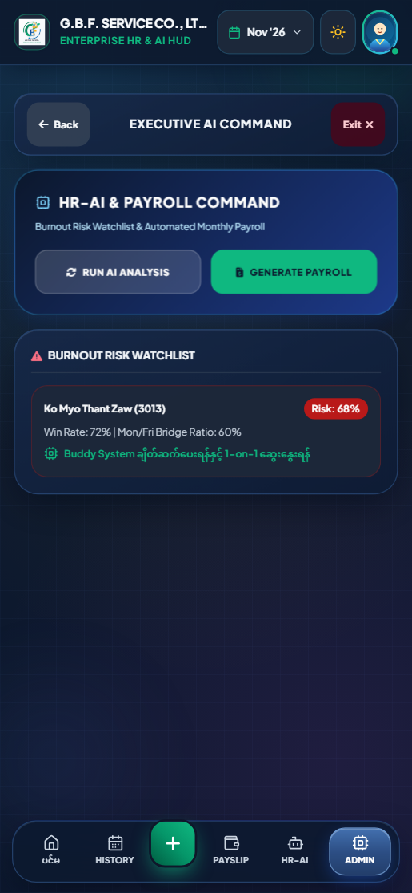 | 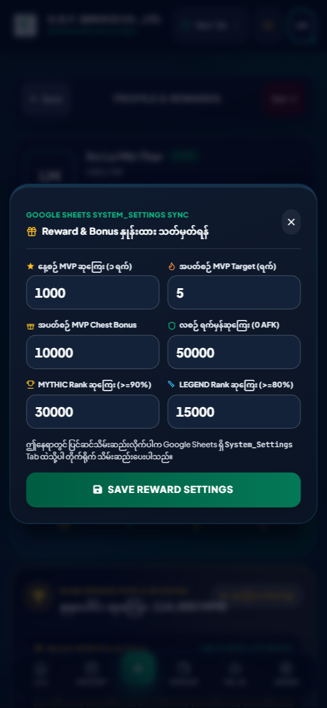 |

* **`Admin` Tab (`nav-ai` — `TM / MM / TL` RBAC Only):**
  * **`🔄 Run AI Analysis`:** ဝန်ထမ်းအားလုံး၏ Win Rate နှင့် Mon/Fri Bridge ratio ကို Gemini AI + O(1) Batch context ဖြင့် တွက်ချက်ကာ **`AI_Predictive_Analytics`** Sheet သို့ သိမ်းဆည်းပြီး **Burnout Risk Watchlist** ထုတ်ပြန်ပေးပါသည်။
  * **`🧾 Generate Payroll`:** ဝန်ထမ်းအားလုံး၏ တစ်လတာ Base Salary, Bonuses, Deductions နှင့် Net Payable ကို Batch တွက်ချက်၍ **`Payroll_Prep_Ledger`** Sheet ထဲသို့ သိမ်းဆည်းပေးပါသည်။ (Staff `JT/TT/ST` မှ ခေါ်ဆိုပါက Server-side RBAC မှ ပယ်ချပါသည်)
* **🎁 Reward, Monthly Working Days & Formula Governance Modal (`Profile` ➔ `ဆုကြေးသတ်မှတ်ရန်`):**
  * `Daily MVP`, `Weekly MVP Target`, `Weekly MVP Chest Bonus`, `0 AFK Attendance Bonus`, `MYTHIC Rank Bonus`, `LEGEND Rank Bonus` နှင့် **`လစဉ် အလုပ်လုပ်ရက် စုစုပေါင်း (WORKING_DAYS_YYYY_MM)`** တို့ကို Edit လုပ်၍ **`SAVE SETTINGS`** နှိပ်ပါက Google Sheets `System_Settings` နှင့် **`KPI_Formula_Registry`** Audit Table သို့ အလိုအလျောက် Sync လုပ်ပေးပါသည်။
  * **`Audit Sheet Sync` ခလုတ်:** တွက်ချက်မှုစည်းမျဉ်း (`KPI-01`..`KPI-10`, `PAY-01`..`PAY-03` — စုစုပေါင်း `13` ချက်) ကို Google Sheets **`KPI_Formula_Registry`** Tab (11th Governance Table) သို့ တိုက်ရိုက် Update လုပ်ပေးပါသည်။

---

## ၉။ Telegram Group Live Board, Private Bot Menu & Multi-Approver Sync (`v9.3.0`)

### ၉.၁ Telegram Group Live Board (`LIVE_EDIT`), Topic Thread & Field Teams Readiness
| **Group Live Attendance Board (`/board`)** | **Field Teams Readiness Badges (`[🗼 Field Teams]`)** |
| :---: | :---: |
| 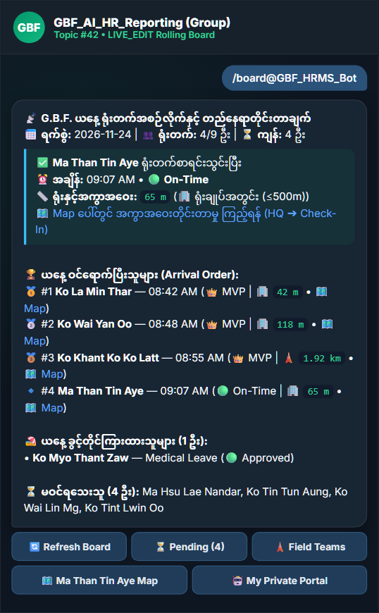 | 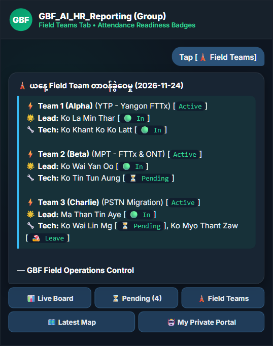 |

* **Single Rolling Daily Card (`GROUP_ATTENDANCE_MODE = LIVE_EDIT`):** တစ်နေ့တာ Check-In / Check-Out ဝင်တိုင်း Group ထဲတွင် စာအစောင်ရေ မဖောင်းပွစေဘဲ ယနေ့ Master Card တစ်စောင်တည်း (`GRP_BOARD_MSG_LATEST`) ကိုသာ `editMessageText` ဖြင့် အချိန်နှင့်တစ်ပြေးညီ Update လုပ်ပေးပါသည်။
* **Group Inline Buttons:**
  * **`[📊 Live Board]` / `[🔄 Refresh Board]`:** Arrival Rank (`🥇 #1`..), KPI, Check-In ➔ Check-Out duration နှင့် HQ Map link များ (လစာ/PIN/ဖုန်းနံပါတ် လုံးဝမပါဝင်)။
  * **`[⏳ Pending (N)]`:** မဝင်ရသေးသူ ဝန်ထမ်းစာရင်းအပြည့် (5-item cap မရှိဘဲ Telegram 4096-char budget အတွင်း safe truncate လုပ်ပေး) + ယနေ့ခွင့်စာရင်း။
  * **`[🗼 Field Teams]`:** Alpha/Bravo/Charlie အဖွဲ့ခွဲများနှင့် Member တစ်ဦးချင်းစီ၏ **`[🟢 In]`**, **`[🏖️ Leave]`**, **`[⏳ Pending]`** Status Badges။
  * **`[🗺️ Map]` & `[🤖 My Private Portal]`:** နောက်ဆုံး Check-In Map နှင့် Private Bot (`t.me/GBF_HRMS_Bot?start=portal`) Deep Link။
* **Forum Topic & Auto Digests:** `TELEGRAM_GROUP_THREAD_ID` ဖြင့် Topic thread သီးသန့်ပို့နိုင်ပြီး `installGroupDigestTriggers()` Run ထားပါက **မနက် `09:20 AM` Roll-Call Digest** နှင့် **ညနေ `06:15 PM` End-of-Day Summary** (တနင်္ဂနွေ ပိတ်ရက်ချန်လှပ်) တို့ကို Group သို့ အလိုအလျောက် ပို့ပေးပါသည်။

### ၉.၂ Scoped Bot Menus & Private In-Place Navigation

| **Private Bot `/start` (`In-Place Edit`)** | **`/askai` 4 Quick Buttons (`Gemini 3.8 Flash`)** |
| :---: | :---: |
| 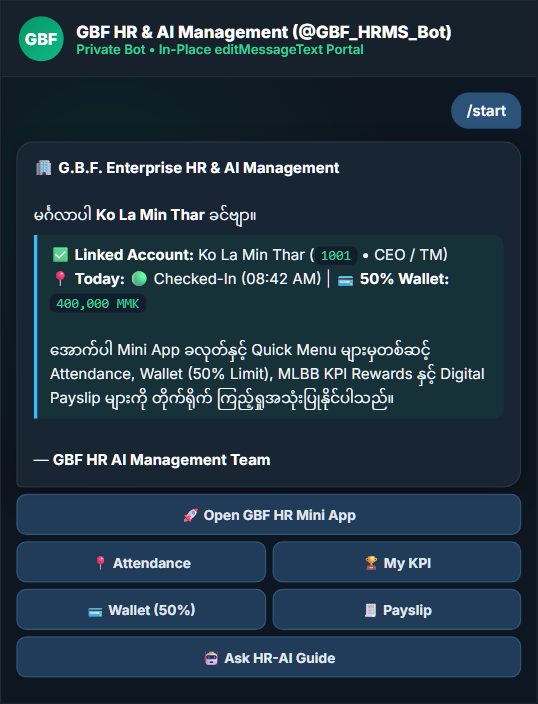 | 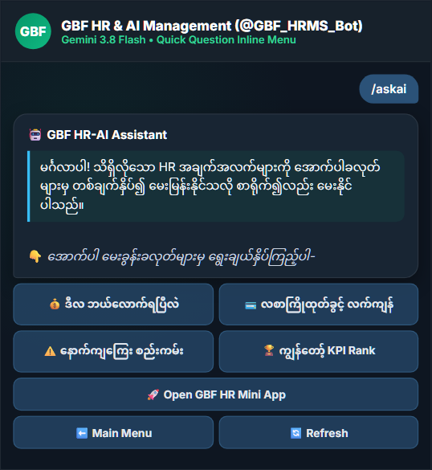 |

* **Privacy-Safe Scoped `/` Command Menus:**
  * **Private Chats (`all_private_chats`, 8 commands):** `/start` (`<tab>` deep-link supported), `/checkin`, `/mykpi`, `/wallet`, `/payslip`, `/askai [မေးခွန်း]`, `/link <PIN>`, `/id`။
  * **Group Chats (`all_group_chats`, 4 commands):** `/board`, `/teams`, `/checkin`, `/id`။ *(Authorized Group `TELEGRAM_GROUP_CHAT_ID` မဟုတ်သော Group များမှ `/board` / `/teams` ခေါ်ဆိုမှုကို Server Auth Gate မှ ပယ်ချပါသည်)*
* **Unified `<blockquote>` Cards & `/askai` 4 Quick Questions:** Private Bot ထဲတွင် `[📍 Attendance]`, `[🏆 My KPI]`, `[💳 Wallet (50%)]`, `[🧾 Payslip]`, `[🤖 Ask HR-AI Guide]` ခလုတ်များကို နှိပ်တိုင်း message အသစ်မထပ်ဘဲ `[⬅️ Main Menu]` / `[🔄 Refresh]` ဖြင့် **In-Place Edit** လုပ်ပေးပြီး `/askai` တွင် စာရိုက်စရာမလိုဘဲ Quick Question ခလုတ် ၄ ခု (`💰 ဒီလ ဘယ်လောက်ရပြီလဲ`၊ `💳 လစာကြိုထုတ်ခွင့် လက်ကျန်`၊ `⚠️ နောက်ကျကြေး စည်းကမ်း`၊ `🏆 ကျွန်တော့် KPI Rank`) ကို တစ်ချက်နှိပ် မေးမြန်းနိုင်ပါသည်။ *(Gemini AI replies များကို `formatAiToTelegramHtml()` ဖြင့် `<b>` HTML tags သို့ ပြောင်းလဲပေးသဖြင့် `**` ကြယ်ပွင့်များ မပေါ်ပါ)*

### ၉.၃ 2-Tier Approver Routing & Multi-Approver Instant Sync
| **Multi-Approver Sibling Sync (`APPROVED ✅`)** | **Approver Workflow & Security** |
| :---: | :--- |
| 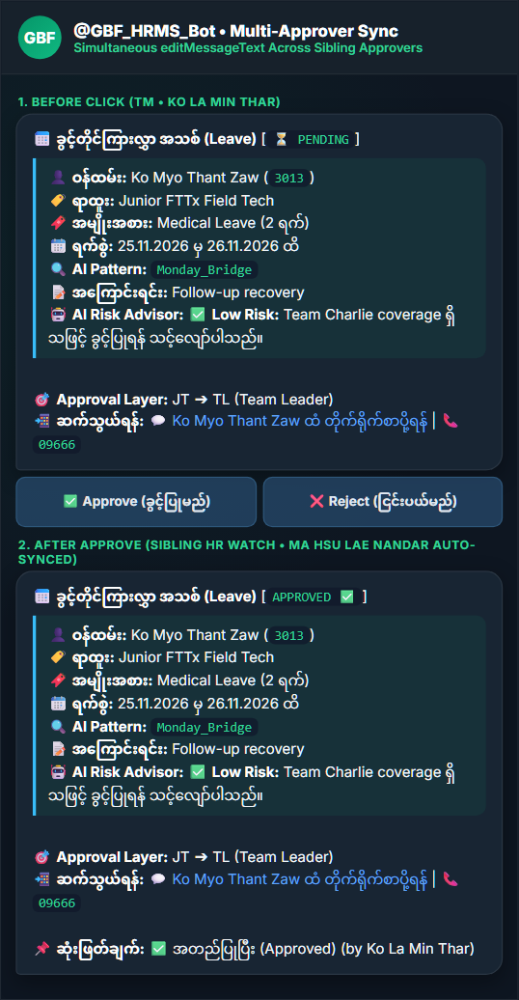 | 1. ဝန်ထမ်းက **Leave**, **Advance**, သို့ **HR Voice** တင်ပြလိုက်သည်နှင့် သက်ဆိုင်ရာ Tier Approvers (**TL** → `TT/JT/ST`, **TM** → `TL/MM`, **HR Watch** CC) အားလုံးထံ **`[✅ Approve]`** / **`[❌ Reject]`** Card ပေးပို့ပြီး Requesting Employee ကိုယ်တိုင်ထံလည်း DM Pending Receipt ပို့ပေးပါသည်။ 2. Approver (၁) ဦးက **`Approve`** သို့ **`Reject`** နှိပ်လိုက်သည်နှင့် —    * **`[⏳ PENDING]`** tag သည် **`[APPROVED ✅]`** (သို့ **`[DECLINED ❌]`**) သို့ ပြောင်းလဲပြီး **Approver အားလုံး၏ Telegram Chat များမှ Inline ခလုတ်များ တစ်ပြိုင်နက် ပျောက်ကွယ်** ၍ ဆုံးဖြတ်သူအမည် + Footer stamp ဖြစ်သွားပါသည်။    * `CacheService` သက်တမ်း (6h) ကုန်သွားသည့်တိုင် **`PENDING_APPROVAL_TARGETS` (`PropertiesService`)** နှင့် **`buildFallbackDecidedCardHtml_`** တို့က formatting မပျက် sync လုပ်ပေးပါသည်။    * အကယ်၍ အခြား Approver တစ်ဦးက stale button ကို ထပ်နှိပ်မိပါက မူလဆုံးဖြတ်ပြီးသား copy များကို မထိခိုက်စေဘဲ clicked copy တစ်ခုတည်းမှ button ကိုသာ ဖယ်ရှားပေးပါသည်။    * Requester Employee ထံသို့လည်း ရလဒ် DM Notification + Quick Portal Buttons ချက်ချင်း ရောက်ရှိပါမည်။ |

---

## ၁၀။ Offline Mode (`IndexedDB` Outbox), Database Schema & Troubleshooting FAQ

* **Offline-First Architecture (`GBF_HR_OfflineDB_v2`):**
  * Watchdog Bridge သည် Fast queries (`8.5s`) နှင့် Heavy RPC (`25s`) Timeout ထားရှိပြီး `GAS_URL` + `google.script.run` နှစ်မျိုးလုံးကို fallback အသုံးပြုပါသည်။
  * အင်တာနက် ပြတ်တောက်နေချိန် Check-In / Request တင်ပြပါက `IndexedDB` **`outbox_queue`** (`idempotencyKey` ပါ) ထဲတွင် သိမ်းဆည်းထားပြီး Sticky Header တွင် **☁️ Outbox Count Pill** ပြသပေးကာ လိုင်းပြန်ရသည်နှင့် Server မှ double-write မဖြစ်စေဘဲ အလိုအလျောက် Sync ပေးပို့ပေးပါသည်။
* **Google Sheets 11 Master Tables (`GBF_DB_SCHEMA`):**
  `HR_Employees`, `Daily_Attendance`, `Leave_Management`, `Advance_Salary`, `Daily_Teams`, `HR_Voice_Feedback`, `AI_Predictive_Analytics`, `Payroll_Prep_Ledger`, `System_Settings`, `System_Audit_Logs`, **`KPI_Formula_Registry`**
* **Auth Architecture Scope (Security Transparency Note):**
  * Telegram Mini App Launch နှင့် `/link` binding များသည် HMAC-SHA256 `tg_id`/`tg_sig` ဖြင့် verified ဖြစ်ပြီး Leader/Admin Actions (`generate_monthly_payroll`, `update_reward_settings`, `sync_formula_registry`, `run_ai_predictions`) ကို `assertAuthorizedRole_` RBAC layer မှ ကာကွယ်ထားပါသည်။ *(Standalone Browser PIN mode နှင့် Digital Payslip GET link များသည် လက်ရှိတွင် `emp_id` parameter ပေါ်အခြေခံထားသဖြင့် Future Release တွင် Signed Session Token Auth ထပ်မံတိုးမြှင့်ရန် CTO Roadmap ထဲတွင် မှတ်တမ်းတင်ထားပါသည်)*
* **အဖြစ်များသော ပြဿနာ ဖြေရှင်းချက်များ (FAQ):**
  1. **"GPS Error: Location ဖွင့်ပေးပါခင်ဗျာ":** ဖုန်း Location (GPS) နှင့် Telegram/Browser Location Permission ကို **Allow** ဖွင့်ပြီး `တိုင်းမည်` ကို ပြန်နှိပ်ပါ။
  2. **"/board နှိပ်သော်လည်း ခွင့်ပြုချက် မရှိပါ ဟုပေါ်နေလျှင်":** Group ထဲတွင် `TELEGRAM_GROUP_CHAT_ID` (`System_Settings`) ထဲသတ်မှတ်ထားသော တရားဝင် Group ဖြစ်ရမည်ဖြစ်ပြီး၊ Private DM တွင် `/link <PIN>` ဖြင့် အရင်ချိတ်ဆက်ထားရပါမည်။
  3. **"/link PIN မှားပြီး Block ဖြစ်သွားလျှင်":** ၁ နာရီအတွင်း ၅ ကြိမ် မှားယွင်းပါက ယာယီ Rate Limit ဖြစ်တတ်သဖြင့် ၁ နာရီစောင့်ပြီး PIN မှန်ကန်စွာ ပြန်ရိုက်ပါ။
  4. **"Group ထဲသို့ 09:20 / 06:15 Digest မပို့သေးလျှင်":** Apps Script Editor တွင် **`installGroupDigestTriggers()`** ကို တစ်ကြိမ် `Run` လုပ်ထားကြောင်းနှင့် `System_Settings` တွင် `GROUP_DIGEST_ENABLED = YES` ရှိကြောင်း စစ်ဆေးပါ။

---
*GBF Enterprise HR & AI Management System `v9.4.0 Production LTS (@44)` — Verified Visual User Manual (23 Application & Telegram Screenshots & Path B Governance).*
