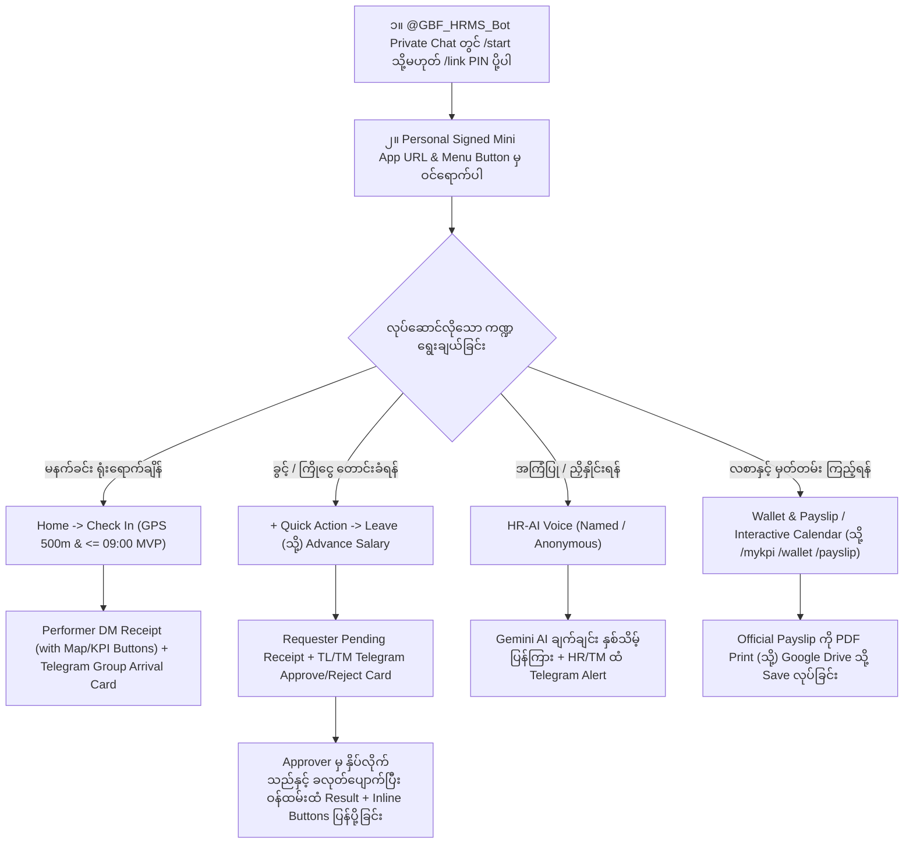

# 📘 GBF Enterprise HR & AI Management System (v9.3.0 Production LTS / @42)
## 🌟 စနစ် လုပ်ဆောင်နိုင်မှုများနှင့် အသုံးပြုသူ လက်စွဲလမ်းညွှန် (System Capabilities & User Manual)

---

## ၁။ စနစ် မိတ်ဆက်နှင့် ဝင်ရောက် အသုံးပြုနည်း (System Overview & Access Points)

**GBF Enterprise HR & AI Management System (`v9.3.0 Production LTS`)** သည် Mobile Legends: Bang Bang (MLBB) စတိုင် **Gamified Performance System**၊ Google Gemini 3.8 Flash AI မော်ဒယ်၊ Scoped Telegram Group & Bot Interactive Command Center နှင့် Telegram Native Mini App တို့ကို ပေါင်းစပ်ဖန်တီးထားသော လုပ်ငန်းခွင် စီမံခန့်ခွဲမှု ပလက်ဖောင်း ဖြစ်ပါသည်။

### 🔗 အသုံးပြုနိုင်သည့် လင့်ခ်များနှင့် ဘော့တ်များ
* **🌐 Web App / Mini App URL:**  
  `https://script.google.com/macros/s/AKfycbyRMUJDUbPJidoXDNrYycqS-WU_AS5Mech41ul7fO88VJYoqKg62SzNmPWkUg0G-kHx/exec`
* **🤖 Telegram Official Bot:**  
  `@GBF_HRMS_Bot` (`https://t.me/GBF_HRMS_Bot`)
* **📊 Master Database (Google Sheets):**  
  `GBF HR Master Database` (Sheets: `HR_Employees`, `Daily_Attendance`, `Leave_Management`, `Advance_Salary`, `Daily_Teams`, `HR_Voice_Feedback`, `AI_Predictive_Analytics`, `Payroll_Prep_Ledger`, `System_Settings`, `System_Audit_Logs`)

### 🔑 စနစ်အတွင်းသို့ ဝင်ရောက်ခြင်းနှင့် Telegram ID ချိတ်ဆက်ခြင်း (Signed SSO & `/link`)
Google Apps Script ၏ Cross-Origin Iframe ကန့်သတ်ချက်ကြောင့် Telegram App မှ ဖွင့်ရာတွင် `#tgWebAppData` ပျောက်ဆုံးမှု မရှိစေရန် **v9.2.4** တွင် **HMAC-SHA256 Signed Deep Link (`?tg_id=&tg_sig=`)** နည်းပညာဖြင့် အဆင့်မြှင့်တင်ထားပါသည်-
1. **Bot မှ `/start` သို့ `/app` နှိပ်၍ ချိတ်ဆက်ခြင်း (Auto-Bind & Auto-SSO):**
   * `@GBF_HRMS_Bot` Private Chat ထဲတွင် `/start` (သို့) `/app` ကို ပို့လိုက်ပါက သင်တစ်ဦးတည်းအတွက် Cryptographic လက်မှတ်ပါဝင်သော Personal Signed URL ဖြင့် **"🚀 Open GBF HR Mini App"** ခလုတ်နှင့် ဘယ်ဘက်အောက်ခြေ **`GBF HR App` Menu Button** တို့ကို အလိုအလျောက် တပ်ဆင်ပေးပါသည်။
   * ထိုခလုတ်မှတစ်ဆင့် ပထမဆုံးအကြိမ် ဝင်ရောက်ပြီး သင်၏ ဝန်ထမ်း PIN (၄) လုံး ရိုက်ထည့်လိုက်သည်နှင့် စနစ်က `HR_Employees` ဇယားတွင် သင်၏ `Telegram_Chat_ID` ကို **အလိုအလျောက် ချိတ်ဆက် (Auto-Bind)** ပေးကာ `"Telegram ID ချိတ်ဆက်ပြီးပါပြီ (Auto-SSO Ready)"` ဟု အတည်ပြုပေးပါမည်။
   * နောက်အကြိမ်များတွင် Bot Menu Button သို့မဟုတ် `/start` မှ ဖွင့်လိုက်ရုံဖြင့် PIN ထပ်ရိုက်စရာမလိုဘဲ **Auto-SSO** ဖြင့် တိုက်ရိုက် ဝင်ရောက်နိုင်ပါမည်။
2. **Chat ထဲမှ `/link <PIN>` ဖြင့် တိုက်ရိုက် ချိတ်ဆက်ခြင်း:**
   * Telegram Bot Private Chat ထဲတွင် `/link 1234` (သင်၏ Official PIN) ဟု ရိုက်ပို့ရုံဖြင့် Chat ID ကို ချက်ချင်း Bind လုပ်နိုင်ပါသည်။
   * *လုံခြုံရေး အကာအကွယ်:* `HR_Employees` ထဲတွင် အခြားသူတစ်ဦး၏ Telegram ID နှင့် ချိတ်ဆက်ထားပြီးသား အကောင့်ကို ထပ်မံပြောင်းလဲခြင်း မပြုနိုင်ရန် **Conflict Guard** ပါရှိပြီး `/link` PIN မှားယွင်းပါက ၁ နာရီလျှင် ၅ ကြိမ်သာ ကြိုးစားခွင့် (Rate Limit) ကန့်သတ်ထားပါသည်။ Bind ပြုလုပ်မှုတိုင်းကို `System_Audit_Logs` (`CHAT_ID_BOUND` / `CHAT_ID_BIND_CONFLICT`) တွင် မှတ်တမ်းတင်ထားပါသည်။
3. **4-Digit Tactical PIN Pad (Web Browser Access):**
   * Browser မှ တိုက်ရိုက်ဝင်ရောက်ပါက အသံနှင့် တုန်ခါမှု (Tactile Audio & Haptics) အထောက်အကူပြု ကီးပတ်ဖြင့် Official PIN ကို ရိုက်နှိပ် ဝင်ရောက်နိုင်ပါသည်။

---

## ၂။ Telegram Bot ၏ အသုံးပြုနိုင်မှုများနှင့် လုပ်ဆောင်ချက်များ (Telegram Bot Capabilities)

GBF HR Telegram Bot (`@GBF_HRMS_Bot`) သည် **v9.2.4** မှစ၍ Direct HTTP `200 OK` Webhook acknowledgement စနစ်သို့ ပြောင်းလဲထားသောကြောင့် Update များ ပိတ်ဆို့ခြင်း (`302 Found`) လုံးဝမရှိဘဲ ၂၄ နာရီ မြန်ဆန်တိကျစွာ အလုပ်လုပ်ပါသည်။

### ၂.၁ Scoped Bot & Group Command Menus (`all_private_chats` vs `all_group_chats` — `v9.3.0`)
Telegram `/` Menu ကို စကားပြောခန်း အမျိုးအစားအလိုက် **Privacy-Safe Scoped Menus** ဖြင့် သီးခြားခွဲ၍ Sync လုပ်ထားပြီး Private Chat Button နှိပ်တိုင်း message အသစ်များ မပွားဘဲ **In-Place Edit** (`[⬅️ Main Menu]`, `[🔄 Refresh]`) ဖြင့် သပ်ရပ်စွာ ပြောင်းလဲပြသပေးပါသည်-
* **Private Chat Menu (8 Commands):**
  * `/start` / `/app` : Personal Signed Mini App URL (`?tg_id=&tg_sig=`), **`GBF HR App` Menu Button** နှင့် `[📍 Attendance]`, `[🏆 My KPI]`, `[💳 Wallet (50%)]`, `[🧾 Payslip]`, `[🤖 Ask HR-AI Guide]` ခလုတ်များ (Group မှ `?start=<tab>` deep link ဖြင့် တိုက်ရိုက်ဖွင့်နိုင်)။
  * `/checkin` : ယနေ့ မိမိ၏ Check-In/Out အခြေအနေ၊ GPS Distance နှင့် Map link ကို Chat ထဲတွင် ချက်ချင်းပြသပြီး Mini App Check-In ခလုတ် ပေးပို့ပါသည်။
  * `/mykpi` : လက်ရှိ MLBB Season Rank (`MYTHIC`–`WARRIOR`), KPI Score `%`, Win Rate `%`, Weekly MVP Streak နှင့် ခန့်မှန်းဆုကြေးများကို ထုတ်ပြပေးပါသည်။
  * `/wallet` : အခြေခံလစာ၊ 50% Max Limit၊ Approved/Pending နှင့် ကျန်ရှိသော ထုတ်ယူနိုင်မည့် Credit လက်ကျန် + မကြာသေးမီ မှတ်တမ်းများ ပြသပေးပါသည်။
  * `/payslip` : ယခုလ Digital Payslip (`Base`, `Attendance`, `MVP/Streak`, `Rank`, `Deductions`, `NET PAYABLE MMK`) ကို Chat ထဲတွင် တိုက်ရိုက်ပြသပေးပါသည်။
  * `/askai [မေးခွန်း]` : `/askai` ချည်းနှိပ်ပါက Quick Question ခလုတ် ၄ ခု (`💰 ဒီလ ဘယ်လောက်ရပြီလဲ`၊ `💳 လစာကြိုထုတ်ခွင့် လက်ကျန်`၊ `⚠️ နောက်ကျကြေး စည်းကမ်း`၊ `🏆 ကျွန်တော့် KPI Rank`) ကို ပြသပေးပြီး၊ `/askai <မေးခွန်း>` ဟု ပို့ပါက `<blockquote>` HTML card ဖြင့် ချက်ချင်း ဖြေကြားပေးပါသည်။
  * `/link <PIN>` : Private Chat ထဲမှနေ၍ သင်၏ Official PIN ဖြင့် Telegram Chat ID ကို ချိတ်ဆက်ပေးပါသည်။
  * `/id` : သင်၏ Telegram Chat ID နှင့် ချိတ်ဆက်ထားပြီးသော ဝန်ထမ်းအမည်/Employee ID ကို တွဲဖက်ဖော်ပြပေးပါသည်။
* **Group Chat Menu (4 Privacy-Safe Commands — authorized official group only):**
  * `/board` : ယနေ့ Group Live Attendance Board ကို Group ထဲတွင် ချက်ချင်းထုတ်ပြပေးပါသည်။
  * `/teams` : ယနေ့ Field Teams (Alpha / Bravo / Charlie) နှင့် အဖွဲ့ဝင်တစ်ဦးချင်းစီ၏ `[🟢 In]` / `[🏖️ Leave]` / `[⏳ Pending]` Readiness Badge များကို ပြသပေးပါသည်။
  * `/checkin` / `/id` : Private Bot Portal (`?start=checkin`) သို့ လွှဲပေးသည့် ခလုတ်နှင့် Group/Topic Chat ID စစ်ဆေးမှု။

### ၂.၂ လုပ်ဆောင်သူတိုင်းထံ တိုက်ရိုက်ပြန်ပို့ပေးသည့် Action Receipts & Multi-Approver Sync
**v9.3.0** တွင် Web App မှ လုပ်ဆောင်ချက်တစ်ခုခု ပြုလုပ်လိုက်တိုင်း လုပ်ဆောင်သူ Private Chat ထံသို့ Receipt Card ပေးပို့သည့်အပြင် Approver များစွာထံ ပို့ထားသော Card များကိုပါ Real-Time Sync ပြုလုပ်ပေးပါသည်-
* **Check-In / Check-Out:** အချိန်၊ Arrival Order (`#1`), KPI (`MVP`/`On-Time`/`Late`), GPS အကွာအဝေး + `[🗺️ ကိုယ်ပိုင် Check-In Map]`, `[🏆 My KPI]`, `[📍 Today Status]`, `[🚀 Open Mini App]` ခလုတ်များ။
* **Leave & Advance + Multi-Approver Sync:** Approver (TL + TM + HR Watch) တစ်ဦးက **Approve / Reject** နှိပ်လိုက်သည်နှင့် အခြား Approver အားလုံး၏ Telegram Chat ထဲရှိ Card များပေါ်မှ Inline ခလုတ်များပါ **တစ်ပြိုင်နက် ပျောက်ကွယ်** သွားပြီး HTML `<b>` / `<blockquote>` formatting မပျက်ဘဲ ဆုံးဖြတ်ချက် Footer ကို STAMP လုပ်ပေးပါသည် (`PropertiesService` durable fallback ပါဝင်)။
* **3-Team Rollout & HR-AI Voice:** အဖွဲ့ခွဲဝေချိန်တွင် ဖွဲ့စည်းသူနှင့် ပါဝင်သူ ဝန်ထမ်းများထံ Team Receipt ပေးပို့ပေးပြီး၊ HR-AI Voice တင်ပြချိန်တွင် Ticket ID + AI Reply Receipt ပေးပို့ပေးပါသည်။

### ၂.၃ Telegram HTML Card Formatting & Gemini HR-AI Chatbot (`v9.2.6`)
* **Markdown-to-HTML Card Engine (`formatAiToTelegramHtml`):** AI မှ ပြန်ဖြေလာသော `**bold**` ကြယ်ပွင့်များ Telegram တွင် မမြင်ရစေရန် `<b>` HTML tags များအဖြစ် အလိုအလျောက် ပြောင်းလဲပေးပြီး ခွင့်၊ ကြိုငွေ၊ Voice နှင့် Attendance Alert Card အားလုံးကို `<blockquote>` စနစ်ဖြင့် သပ်ရပ်စွာ ပေးပို့ပါသည်။
* Private Chat တွင် Command မဟုတ်သော မေးခွန်းများ (သို့ `/askai <မေးခွန်း>`) ကို မြန်မာဘာသာဖြင့် စာရိုက်မေးမြန်းပါက AI Assistant က ချိတ်ဆက်ထားသော ဝန်ထမ်း၏ လက်ရှိ KPI/Advance context ကိုပါ ထည့်သွင်းစဉ်းစား၍ Inline Quick Action ခလုတ်များနှင့်အတူ ပြန်လည်ဖြေကြားပေးပါသည်။

### ၂.၄ ၂-ဆင့် အတည်ပြုသူများအတွက် စမတ် Action Center (2-Tier Approver Routing)
ဝန်ထမ်းများက Web App မှ တင်ပြလာသော တောင်းဆိုမှုများကို ရာထူးအလွှာ (`POS_LAYER_TL_TARGETS`, `POS_LAYER_TM_TARGETS`) အလိုက် သက်ဆိုင်ရာ Team Leader (`TL`) သို့မဟုတ် Top Management (`TM`) ထံသို့ Telegram Interactive Card ဖြင့် ချက်ချင်း ပေးပို့ပါသည်-

1. **ခွင့်တိုင်ကြားလွှာများ (`LV_APP_` / `LV_REJ_`):**
   * ဝန်ထမ်းအမည်၊ ရာထူး၊ ခွင့်အမျိုးအစား၊ ရက်စွဲ၊ အကြောင်းပြချက်။
   * **Gemini AI Risk Advisor:** စနေ/တနင်္ဂနွေနှင့် ဆက်စပ်တံတားထိုးခွင့် (`Monday_Bridge` / `Friday_Bridge`) ဟုတ်/မဟုတ်နှင့် အဖွဲ့ဝန်ထမ်းအင်အား ထိခိုက်နိုင်ခြေကို AI မှ သုံးသပ်ပြသခြင်း။
   * ခလုတ်များ- `[✅ ခွင့်ပြုမည်]` / `[❌ ငြင်းပယ်မည်]`။
2. **လစာကြိုထုတ် လျှောက်ထားလွှာများ (`ADV_APP_` / `ADV_REJ_`):**
   * တောင်းခံငွေပမာဏ၊ ၅၀% ကန့်သတ်ချက် လက်ကျန်၊ အကြောင်းရင်း။
   * **Gemini AI Risk Advisor:** ကြိုတင်ငွေတောင်းခံမှု မှတ်တမ်းနှင့် ဘဏ္ဍာရေးအန္တရာယ် သုံးသပ်ချက်။
   * ခလုတ်များ- `[✅ ခွင့်ပြုမည်]` / `[❌ ငြင်းပယ်မည်]`။
3. **ဝန်ထမ်း အကြံပြု/တိုင်ကြားလွှာများ (`VOC_ACK_` / `VOC_MEET_`):**
   * Ticket ID, AI Sentiment Analysis, ကဏ္ဍ၊ တင်ပြချက် (အမည်ဖော်ပြထားပါက Direct Contact Link ပါဝင်)။
   * ခလုတ်များ- `[🤝 လက်ခံညှိနှိုင်းမည်]` / `[📅 ရုံးခန်းချိန်းဆိုမည်]`။

> **⚡ Anti-Loop Deduplication & Instant Button Removal:**  
> `CacheService` နှင့် `LockService` ဖြင့် ထပ်ခါတလဲလဲ ဝင်လာခြင်းကို တားဆီးထားပြီး၊ ခွင့်ပြုသူက ခလုတ်နှိပ်လိုက်သည်နှင့် တစ်ပြိုင်နက် Inline ခလုတ်များ ချက်ချင်း ဖယ်ရှားခံရကာ ဆုံးဖြတ်ချက် မှတ်တမ်းစာသားဖြင့် အစားထိုးပေးပါသည်။

### ၂.၅ Interactive Group Live Board, Topic Threads & Scheduled Digests (`v9.3.0`)
Telegram Group ထဲသို့ စာအစောင်ရေများစွာ ပြည့်ကျပ်မနေစေရန် **v9.3.0** တွင် `GROUP_ATTENDANCE_MODE` ကို **`LIVE_EDIT`** (တစ်နေ့လျှင် Rolling Board Card တစ်စောင်တည်းကို အချိန်နှင့်တစ်ပြေးညီ Update လုပ်ခြင်း) အဖြစ် မူရင်းသတ်မှတ်ထားပြီး အောက်ပါခလုတ်များဖြင့် In-Place Switch ကြည့်ရှုနိုင်ပါသည်-
* **`[📊 Live Board]` / `[🔄 Refresh Board]`:** Arrival Order (`🥇 #1`..), `👑 MVP EARLY` / `On-Time` / `Late` Badge, Check-In ➔ Out အလုပ်ချိန်နာရီ၊ `HQ Zone` vs `Field Site` GPS အကွာအဝေးနှင့် Maps လမ်းညွှန် (Privacy Gate ကြောင့် Group Board တွင် လစာ/PIN/ဖုန်းနံပါတ် လုံးဝမဖော်ပြပါ)။
* **`[⏳ Pending (N)]`:** မဝင်ရသေးသူ ဝန်ထမ်းစာရင်းအပြည့် (5-item cap မရှိဘဲ Telegram 4096-char budget အတွင်း စနစ်တကျ ဖော်ပြ) + ယနေ့ခွင့်စာရင်း။
* **`[🗼 Field Teams]`:** `Daily_Teams` မှ Alpha/Bravo/Charlie အဖွဲ့စာရင်းနှင့် Member တစ်ဦးချင်းစီ၏ `[🟢 In]` / `[🏖️ Leave]` / `[⏳ Pending]` Readiness Badge များ။
* **`[🗺️ Map]` & `[🤖 My Private Portal]`:** နောက်ဆုံးဝင်ရောက်သူ၏ Google Maps link နှင့် Bot DM (`?start=portal`) Deep Link။
* **Forum Topic Support & Scheduled Digests:** `TELEGRAM_GROUP_THREAD_ID` ဖြင့် Telegram Forum Topic သီးသန့်ထဲသို့ ပို့နိုင်ပြီး `GROUP_DIGEST_ENABLED = YES` ဖြစ်ပါက မနက် **09:20 AM Roll-Call** နှင့် ညနေ **06:15 PM End-of-Day Summary** (တနင်္ဂနွေ ပိတ်ရက်ချန်လှပ်) တို့ကို `installGroupDigestTriggers()` မှတစ်ဆင့် အလိုအလျောက် ပေးပို့ပေးပါသည်။

---

## ၃။ Web App / Mini App ၏ အဓိက လုပ်ဆောင်ချက်များ (Web App Core Modules)

### ၃.၁ 🏆 ပင်မစာမျက်နှာနှင့် Gamified MLBB System (`Home` & `Profile & Rewards`)
ဝန်ထမ်းများ၏ ရုံးတက်ရောက်မှုနှင့် စည်းကမ်းလိုက်နာမှုကို MLBB KPI Score (0–100%) စနစ်ဖြင့် တိုင်းတာထားပါသည်-
* **KPI Score တွက်ချက်ပုံ:** Reliability (40%) + Punctuality (40%) + Behavior (20% - Late/AFK/Strike ဖြတ်တောက်ချက်)
* **Rank အဆင့်များ (5 Tiers):**
  * 🌟 **MYTHIC** (`KPI >= 90%`, 5 Stars) → Rank Bonus **+၃၀,၀၀၀ ကျပ်** (Default)
  * ⚔️ **LEGEND** (`KPI >= 80%`, 4 Stars) → Rank Bonus **+၁၅,၀၀၀ ကျပ်** (Default)
  * 🛡️ **EPIC** (`KPI >= 60%`, 3 Stars)
  * 🎖️ **ELITE** (`KPI >= 40%`, 2 Stars)
  * 🔰 **WARRIOR** (`KPI < 40%` သို့မဟုတ် ရုံးတက်ရက် `0`, 1 Star)
* **Home Dashboard Components:**
  * **Swipeable 3-Slide MLBB Hero Radar Card:**
    1. *5-Axis Hero Radar Chart* + Win Rate
    2. *Battle Telemetry:* Present / 26 Workdays ဘားနှင့် နှိပ်၍စစ်ဆေးနိုင်သော `MVP`, `OnTime`, `Late`, `AFK` ခလုတ်များ (Single Metric Inspector)
    3. *Rewards & Wallet Snapshot:* စုစုပေါင်း ရရှိပြီး ဆုကြေးနှင့် 50% Wallet လက်ကျန်
  * **Today Checked-In Avatar Stack Inspector:** ယနေ့ 🟢 ဝင်ရောက်ပြီးသူများ၊ 🏖️ ယနေ့ခွင့်ယူသူများနှင့် ⏳ မဝင်ရသေးသူများကို Filter ခွဲကြည့်ခြင်း + `HQ ➔ Map` လင့်ခ်
  * **Active Battle Squads:** ယနေ့ တာဝန်ကျ Alpha/Beta/Charlie အဖွဲ့စာရင်းများ
* **Profile & Rewards Tab:**
  * ကိုယ်ပိုင် Profile ပုံ ပြောင်းလဲခြင်း (Upload Photo)၊ Strike Count (`0/3`) စစ်ဆေးခြင်း၊ `Switch PIN` (Logout)
  * **Weekly MVP Streak Chest** ကြယ် ၅ ပွင့် မှတ်တမ်းနှင့် KPI Breakdown Table Filter (`All`, `MVP`, `On-Time`, `Late`, `AFK`)
  * *(TM / MM / TL RBAC Only)* **🎁 Reward Settings Modal:** နေ့စဉ် MVP ဆုကြေး၊ Weekly Streak Bonus၊ Perfect Attendance Bonus၊ Mythic/Legend Rank Bonus နှုန်းထားများကို App ထဲမှတစ်ဆင့် Google Sheets `System_Settings` ထဲသို့ တိုက်ရိုက် ပြင်ဆင်သိမ်းဆည်းနိုင်ခြင်း။

---

### ၃.၂ 📍 စမတ်ကျသော ရုံးတက်/ရုံးဆင်းစနစ် (Smart Attendance & Geofencing)
* **GPS Geofencing & Live Distance Bar:** ရုံးချုပ်တည်နေရာ (Default: `16.804683, 96.177149`) မှ **မီတာ ၅၀၀** အတွင်း ရှိ/မရှိ တိုင်းတာပြီး `တိုင်းမည်` ခလုတ်နှင့် Google Maps `Map` လမ်းညွှန်လင့်ခ်ဖြင့် ချက်ချင်း စစ်ဆေးနိုင်ပါသည်။
* **အချိန်အလိုက် ဂုဏ်ပြုဆုနှင့် အဆင့်ခွဲခြားမှု (Yangon `GMT+6:30`):**
  * 🌟 **မနက် ၀၉:၀၀ နှင့် ၎င်းမတိုင်မီ (`<= 09:00`):** **MVP** (နေ့စဉ် Bonus **+၁,၀၀၀ ကျပ်** စာရင်းဝင်)
  * ✅ **မနက် ၀၉:၀၁ မှ ၀၉:၁၅ အတွင်း (`<= 09:15`):** **On-Time** (အချိန်မှန်)
  * ⚠️ **မနက် ၀၉:၁၅ နောက်ပိုင်း (`> 09:15`):** **Late** (နောက်ကျ)
* **Field Site Verification:** မီတာ ၅၀၀ ပြင်ပ နယ်မြေကွင်းဆင်းဆိုက်များမှ Check-In / Check-Out ပြုလုပ်ပါက `Out_of_Range` (Field Site) အဖြစ် အကွာအဝေးနှင့်တကွ မှတ်တမ်းတင်ပေးပါသည်။

---

### ၃.၃ 📅 မှတ်တမ်းပြက္ခဒိန်နှင့် Timeline (`History` Tab)
* **Interactive Calendar:** **Weekly (အပတ်စဉ်)**၊ **Daily (နေ့စဉ်)** နှင့် **Monthly (လစဉ်)** မြင်ကွင်း ၃ မျိုးဖြင့် မိမိ၏ ရုံးတက်/ခွင့်/နောက်ကျ မှတ်တမ်းများကို ပြက္ခဒိန်ပေါ်တွင် ကြည့်ရှုနိုင်ပြီး နေ့စွဲအလိုက် Vertical Timeline ကို စစ်ထုတ်ကြည့်ရှုနိုင်ပါသည်။

---

### ၃.၄ 📝 ခွင့်တိုင်ကြားမှု စနစ် (`+` Quick Action -> `Leave Request`)
* **ခွင့်အမျိုးအစားများ:** Casual Leave (ရှောင်တခင်ခွင့်), Medical Leave (ဆေးခွင့်), Annual Leave (လုပ်သက်ခွင့်)။
* **စမတ် လုပ်ဆောင်ချက်:** စတင်ရက်နှင့် ပြီးဆုံးရက် ရွေးချယ်၍ အကြောင်းရင်း ဖြည့်သွင်းပေးပို့လိုက်ပါက Gemini AI က `Monday_Bridge` / `Friday_Bridge` နှင့် အန္တရာယ်သုံးသပ်ချက် ထည့်သွင်းပြီး သက်ဆိုင်ရာ Team Leader / Top Management ၏ Telegram သို့ ချက်ချင်း ပေးပို့ပေးပါသည်။ Approved Leaves များသည် Absent (AFK) စာရင်းထဲသို့ မဝင်ဘဲ KPI Reliability ကို ကာကွယ်ပေးပါသည်။

---

### ၃.၅ 💰 ဒစ်ဂျစ်တယ် ပိုက်ဆံအိတ်နှင့် လစာကြိုထုတ်ခွင့် (`Wallet & Payslip` / `Advance Salary`)
* **၅၀% အကာအကွယ် စည်းမျဉ်း:** ဝန်ထမ်းတစ်ဦးသည် မိမိ၏ အခြေခံလစာ၏ အများဆုံး **၅၀%** အထိသာ ကြိုတင်ထုတ်ယူနိုင်အောင် စနစ်မှ ကန့်သတ်ထိန်းချုပ်ထားပါသည်။
* **50% Limit Progress Bar & Quick Chips (`v9.2.6`):** ထုတ်ယူပြီးပမာဏနှင့် ကျန်ရှိသော Limit ကို Progress Bar ဖြင့် ချက်ချင်းပြသပေးပြီး စာရိုက်စရာမလိုဘဲ **`50,000`**, **`100,000`**, **`Max`** Quick Amount Chips များဖြင့် တစ်ချက်နှိပ် ရွေးချယ်တောင်းခံနိုင်ပါသည်။
* **တိုက်ရိုက် လက်ကျန်ပြသမှု:** Approved + Pending ငွေပမာဏများကို နုတ်ပယ်ပြီး ကျန်ရှိသော ထုတ်ယူနိုင်သည့် Credit Balance ကို Gauge ဘားဖြင့် ပြသပေးပါသည်။

---

### ၃.၆ 🗣️ ဝန်ထမ်းများ၏ အသံနှင့် ညှိနှိုင်းမှု ကဏ္ဍ (`HR-AI Voice & Support`)
* **ကဏ္ဍ ၄ မျိုး:** ⚙️ လုပ်ငန်းခွင် အခက်အခဲ (Field Issues)၊ 🤝 တောင်းဆိုညှိနှိုင်းမှု၊ 🛠️ စက်ပစ္စည်း လိုအပ်ချက် (Splicer / OTDR)၊ 💡 တိုးတက်ရေး အကြံပြုချက်။
* **Anonymous Mode:** မိမိအမည် ဖော်ပြ၍ဖြစ်စေ၊ **အမည်ဝှက် (Anonymous)** ဖြင့်ဖြစ်စေ ပေးပို့နိုင်ပြီး Gemini 3.8 Flash AI က စိတ်ခံစားမှု (Sentiment) ခွဲခြမ်းစိတ်ဖြာကာ ယဉ်ကျေးပျူငှာသော အလိုအလျောက် အကြောင်းပြန်စာ ချက်ချင်း ပြန်ပို့ပေးပါသည်။

---

### ၃.၇ 🗼 ကွင်းဆင်းလုပ်ငန်းခွင် ၃-ဖွဲ့ တာဝန်ခွဲဝေမှု (`3-Team Rollout`)
* **Teams & Projects:** **Team 1 (Alpha)**, **Team 2 (Beta)**, **Team 3 (Charlie)** အဖွဲ့များကို **YTP - Yangon FTTx**, **MPT - FTTx & ONT**, **PSTN Migration** ပရောဂျက်များအတွက် အဖွဲ့ဝင်များ ရွေးချယ်ဖွဲ့စည်းနိုင်ပြီး Google Sheets `Daily_Teams` ထဲသို့ သိမ်းဆည်းကာ Telegram Group သို့ ချက်ချင်း Broadcast ပေးပို့နိုင်ပါသည်။

---

### ၃.၈ 🧠 Executive HR-AI Command Center (`Admin` Tab — `TM / MM / TL` RBAC Only)
ခေါင်းဆောင်ပိုင်း (`TM`, `MM`, `TL`) များအတွက် သီးသန့် Dashboard ကဏ္ဍ ဖြစ်ပါသည်-
* **Run AI Analysis:** ဝန်ထမ်းတစ်ဦးချင်းစီ၏ တက်ရောက်မှု Win Rate၊ တနင်္လာ/သောကြာ ခွင့်ယူနှုန်းတို့ကို Gemini AI ဖြင့် တွက်ချက်ပြီး **Burnout Risk Watchlist** ထုတ်ပြန်ပေးခြင်း။
* **Generate Payroll:** တစ်လတာ ဝန်ထမ်းအားလုံး၏ လစာ၊ ဘောနပ်စ်နှင့် ဖြတ်တောက်ငွေများကို တစ်ချက်တည်း Batch Processing ဖြင့် တွက်ချက်၍ `Payroll_Prep_Ledger` ထဲသို့ ထည့်သွင်းခြင်း။

---

### ၃.၉ 🧾 ဂိမ်းဆန်သော လစာတွက်ချက်မှုနှင့် ဒစ်ဂျစ်တယ် လစာစလစ် (`Wallet & Payslip`)

#### 🎁 ဘောနပ်စ်နှင့် ဆုကြေးများ (Default နှုန်းထားများ — Admin မှ ပြင်ဆင်နိုင်)
1. **ရုံးတက်မှန်ဆု (`Attendance Bonus`):** ရုံးတက်ရက်ရှိပြီး ခွင့်မဲ့ပျက်ကွက် (`AFK`) လုံးဝ **0** ဖြစ်ပါက **၅၀,၀၀၀ ကျပ်**။
2. **နေ့စဉ် MVP ဆု (`Daily MVP Bonus`):** မနက် ၀၉:၀၀ နှင့် ၎င်းမတိုင်မီ ရောက်ရှိသည့် နေ့တိုင်းအတွက် **၁,၀၀၀ ကျပ် / ရက်**။
3. **တစ်ပတ်တာ စံပြဆု (`Weekly MVP Streak`):** ISO Week (တနင်္လာ–တနင်္ဂနွေ) တစ်ပတ်အတွင်း MVP **၅ ရက်** ပြည့်သည့် အပတ်တိုင်းအတွက် **၁၀,၀၀၀ ကျပ် / အပတ်**။
4. **Rank ဆုကြေး (`Rank Bonus`):** **MYTHIC** (+**၃၀,၀၀၀ ကျပ်**)၊ **LEGEND** (+**၁၅,၀၀၀ ကျပ်**)။

#### ⚠️ စည်းကမ်းထိန်းသိမ်းမှု ဖြတ်တောက်ချက်များ
1. **နောက်ကျခြင်း (`Late Penalty`):** တစ်လလျှင် **၃ ကြိမ်အထိ ကင်းလွတ်ခွင့်** ပေးပြီး **၄ ကြိမ်မြောက်မှစ၍** `(နောက်ကျအကြိမ် - 3) × 2,000 ကျပ်` နုတ်ယူပါသည်။
2. **ခွင့်မဲ့ပျက်ကွက်ခြင်း (`AFK Deduction`):** ခွင့်မဲ့ ၁ ရက်လျှင် `(အခြေခံလစာ ÷ 26)` နှုန်းဖြင့် နုတ်ယူပါသည်။
3. **3-AFK Forfeiture Rule:** တစ်လအတွင်း **AFK ၃ ကြိမ်နှင့်အထက်** ပြည့်ပါက Rank ကို `ELITE` သို့ လျှော့ချပြီး Daily MVP, Weekly Streak, Attendance Bonus နှင့် Rank Bonus များ အားလုံး အလိုအလျောက် ပျက်ပြယ်ပါမည်။
4. **ကြိုတင်လစာ နှုတ်ယူမှု:** Approved Advance Salary ပမာဏကို Net Payable မှ အလိုအလျောက် ရှင်းလင်းနုတ်ယူပေးပါသည်။

#### 📄 Official Payslip & Export
* **Always-Visible Official Payslip:** လစဉ် လစာစလစ် အသေးစိတ်ကို `Wallet & Payslip` Tab တွင် ကြည့်ရှုနိုင်ခြင်း။
* **Print / PDF & Drive Sync:** **`PDF`** ခလုတ်ဖြင့် Print / PDF ထုတ်ယူနိုင်သည့်အပြင် **`Drive`** ခလုတ်ဖြင့် **Google Drive** ထဲသို့ PDF ဖိုင်အဖြစ် တိုက်ရိုက် Export သိမ်းဆည်းနိုင်ပါသည်။

---

### ၃.၁၀ ⚡ အော့ဖ်လိုင်း အထောက်အကူပြုစနစ်နှင့် UX Features
* **Offline Outbox (`IndexedDB`) & Form Drafts (`localStorage`):** အင်တာနက်လိုင်း ပြတ်တောက်နေချိန်တွင် Check-In နှင့် တင်ပြချက်များကို Outbox ထဲတွင် သိမ်းဆည်းထားပြီး လိုင်းပြန်ရသည်နှင့် အလိုအလျောက် Sync ပေးပို့ပေးပါသည်။ Form ရိုက်လက်စ စာသားများကိုလည်း Auto-Save ပေးထားပါသည်။
* **Dark Slate Theme Default, WCAG Contrast & Compact Month Switcher (`v9.2.7`):** `#0F172A` / `#1E293B` Dark Slate ကို မူရင်းဒီဇိုင်းအဖြစ် အသုံးပြုထားပြီး WCAG 2.1 AA Contrast pairs၊ Keyboard `:focus-visible` ring၊ Screen-Reader `aria-live` / Chart summary၊ Full `prefers-reduced-motion` support၊ `>=44px` Touch Target၊ မြန်မာစာ `line-height: 1.65` နှင့် Compact **Month Switcher Popover** (`Nov '26` ▾) တပ်ဆင်ထားပါသည်။

---

## ၄။ အသုံးပြုခွင့် အဆင့်သတ်မှတ်ချက်များ (Role-Based Access Control - RBAC)

| Role Code | ရာထူးအဆင့် | လုပ်ပိုင်ခွင့်နှင့် အခန်းကဏ္ဍ |
| :--- | :--- | :--- |
| **TM** | Top Management | စနစ်တစ်ခုလုံး စီမံခန့်ခွဲခွင့်၊ `TL/MM` ခွင့်နှင့် လစာကြိုထုတ်ခွင့် Telegram အတည်ပြုခွင့်၊ AI Watchlist၊ Batch Payroll Generation၊ Reward Settings ပြင်ဆင်ခွင့်။ |
| **MM** | Middle Management | ဌာနအလိုက် စွမ်းဆောင်ရည် စစ်ဆေးခွင့်၊ `Admin` Command Tab အသုံးပြုခွင့်၊ HR Voice ညှိနှိုင်းခွင့်။ |
| **TL** | Team Leader | `TT/JT/ST` အဖွဲ့ဝင်များ၏ ခွင့်တိုင်ကြားမှုများကို Telegram မှ Approve/Reject ပြုလုပ်ခွင့်၊ 3-Team Rollout ဖွဲ့စည်းခွင့်၊ `Admin` Command Tab အသုံးပြုခွင့်။ |
| **ST / JT / TT** | Senior, Junior & Trainee Techs | GPS Check-In/Out၊ ခွင့်တိုင်ကြားခြင်း၊ 50% Advance Salary တောင်းခံခြင်း၊ HR-AI Voice တင်ပြခြင်း၊ Calendar/History နှင့် Official Payslip ကြည့်ရှုခြင်း။ |

---

## ၅။ လက်တွေ့ အသုံးပြုနည်း အဆင့်ဆင့် လမ်းညွှန် (Quick Start Flowchart)

---
*GBF Enterprise HR & AI Management System v9.3.0 Production LTS (`@42`) — Fully Verified & Operational.*
